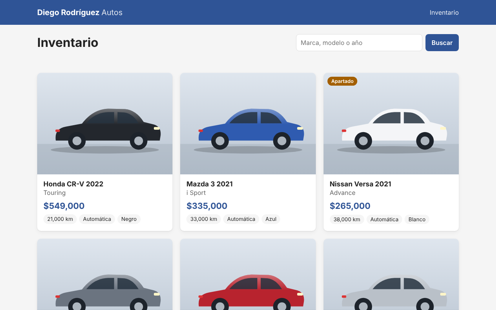

# diegorodriguezautos.com

Website for **Diego Rodríguez Autos**, a used-car dealership: a public inventory page plus a password-protected admin panel to manage vehicles. Vehicle photos are linked from Google Drive, so no image files are stored on the server.



## Tech stack

| Layer | Technology | Purpose |
|---|---|---|
| Frontend | **HTML5, CSS3, vanilla JavaScript** (no framework, no build step) | Public inventory page and admin panel. DOM is built with `<template>` + `textContent` only |
| Backend | **Node.js** 20+ (developed on 22 LTS) | Runtime |
| | **Express** 5 | HTTP server, routing and static files (`public/` only) |
| | **mysql2** 3 (promise API) | MySQL driver with connection pooling and prepared statements (`execute` + `?` placeholders) |
| | **helmet** 8 | Security headers, including a strict Content-Security-Policy |
| | **dotenv** | Loads secrets from a non-committed `.env` file |
| | Node `crypto` (built-in) | `scrypt` password hashing and HMAC-SHA256 signed session cookies |
| Database | **MySQL** 8 (InnoDB, `utf8mb4`) | Vehicles, image links, customers, sales and payments, with foreign keys and `CHECK` constraints |
| Images | **Google Drive** share links | Stored as URLs only and normalized to Drive's thumbnail endpoint |
| Infrastructure | **Hostinger VPS** running Ubuntu 22.04/24.04 | Hosting |
| | **Nginx** | Reverse proxy, login rate limiting, blocks dotfiles |
| | **PM2** | Keeps the Node process alive and restarts it on boot |
| | **Let's Encrypt** (Certbot) | Free HTTPS certificate with auto-renewal |
| | **UFW** | Firewall: only SSH, HTTP and HTTPS are open |
| Testing | **node:test** (built-in test runner) | 26 security tests against a real MySQL test database |

## Architecture

```
Browser ──HTTPS──> Nginx (80/443) ──> Node.js + Express (127.0.0.1:3000) ──> MySQL (127.0.0.1:3306)
   │
   └── images are loaded directly from Google Drive (never through the VPS)
```

## Project structure

```
public/                  The only folder served to the internet
  index.html, admin.html
  css/styles.css
  js/comun.js, app.js, admin.js
src/                     Server code (never served)
  app.js                 Express app, security headers, error handling
  auth.js                Admin login, signed session cookie, CSRF and brute-force protection
  db.js                  MySQL connection pool
  validacion.js          Whitelist input validation and image URL normalization
  vehiculos.js           All SQL queries (parameterized)
  routes/                Public API and admin API
db/schema.sql            Tables and constraints
db/datos-ejemplo.sql     Sample data for SQL practice
scripts/crear-admin.js   Generates the admin password hash and session secret
test/seguridad.test.js   Security test suite
deploy/nginx.conf        Nginx site configuration
docs/                    User manual and guides (Spanish)
```

## Security

- **SQL injection:** every query uses prepared statements; multiple statements are disabled; IDs, enums and numeric fields are strictly validated; `LIKE` wildcards are escaped. The production database user only has `SELECT, INSERT, UPDATE, DELETE`.
- **HTML injection / XSS:** no `innerHTML` anywhere; all data is rendered as text. The CSP allows only same-origin scripts and styles, with no inline code.
- **Admin access control:** single admin with a `scrypt` password hash; an HMAC-signed cookie that is `HttpOnly`, `Secure` and `SameSite=Strict` with an 8-hour expiry; Origin checks and JSON-only request bodies against CSRF; brute-force limits in both Node and Nginx.
- **Image links:** only `https://` URLs are accepted; `javascript:`, `data:` and `http:` are rejected.
- **Secrets:** stored only in `.env` on the server; `.gitignore` blocks env files, keys and database dumps.

Details and test coverage: [docs/06-seguridad.md](docs/06-seguridad.md).

## Getting started (local)

Requirements: Node.js 20+ and MySQL 8.

```bash
npm install
cp .env.example .env            # set NODE_ENV=development and your MySQL credentials
mysql -u root -p -e "CREATE DATABASE agencia_autos CHARACTER SET utf8mb4 COLLATE utf8mb4_unicode_ci"
mysql -u root -p agencia_autos < db/schema.sql
npm run crear-admin             # paste the 3 printed lines into .env
npm start                       # http://127.0.0.1:3000  and  http://127.0.0.1:3000/admin
```

## Scripts

| Command | Description |
|---|---|
| `npm start` | Start the server (`server.js`) |
| `npm run crear-admin` | Interactively create the admin credentials for `.env` |
| `npm test` | Run the security tests (requires a `.env.test` pointing to a database whose name contains `test`) |

## Documentation (Spanish)

The full user manual lives in [`docs/`](docs/README.md):

1. [Public page](docs/01-pagina-publica.md): browsing, searching, photo gallery
2. [Admin panel](docs/02-panel-admin.md): login, add, edit, status and delete vehicles
3. [Photos from Google Drive](docs/03-fotos-google-drive.md): how to share and paste image links
4. [VPS installation](docs/04-instalacion-vps.md): DNS, MySQL, PM2, Nginx, HTTPS on Hostinger
5. [MySQL practice over SSH](docs/05-practica-mysql-ssh.md): separate practice database with solved exercises
6. [Security](docs/06-seguridad.md): protections and how they were tested
