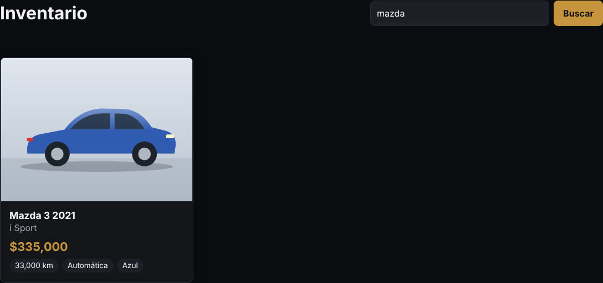
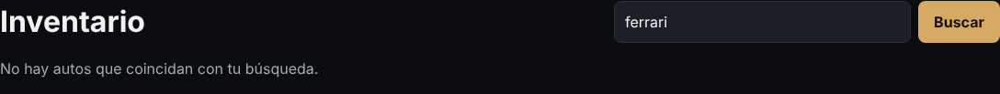
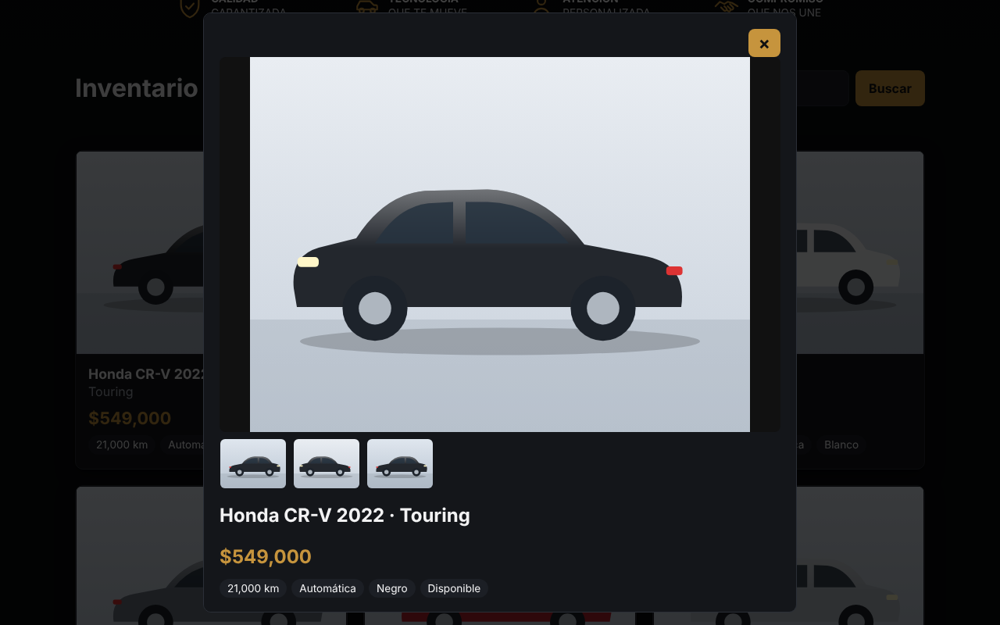
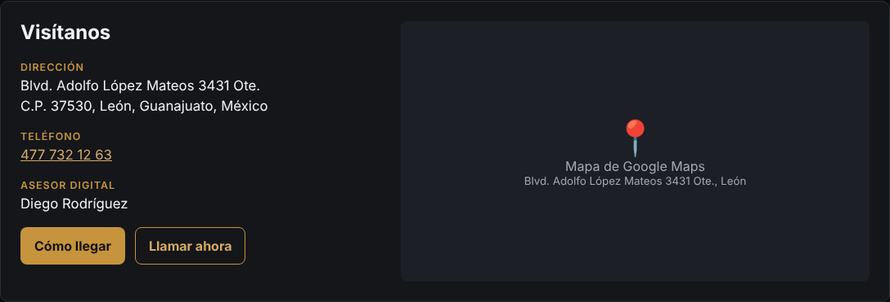
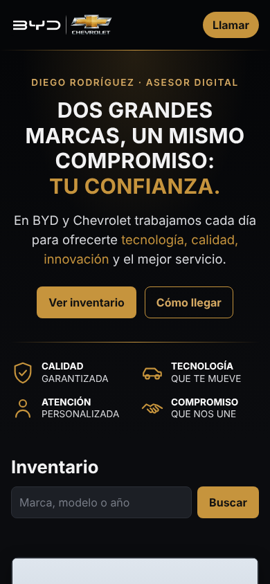

# 1. Página pública

[← Volver al índice](README.md)

Es lo que ve cualquier persona en `https://diegorodriguezautos.com/`. No necesita cuenta.

La página tiene, de arriba a abajo: **encabezado** con el logo BYD | Chevrolet, **portada**, **inventario**, **ubicación** y **pie de página**.

## Encabezado y portada

- El **encabezado** se queda fijo arriba al bajar por la página. Tiene accesos a **Inventario**, **Ubicación** y el botón dorado **Llamar** (en el celular marca directo al 477 732 12 63).
- La **portada** muestra el mensaje "Dos grandes marcas, un mismo compromiso: tu confianza." con los botones **Ver inventario** y **Cómo llegar**, y los cuatro valores: calidad, tecnología, atención personalizada y compromiso.

## Inventario

Cada tarjeta muestra:

- **Foto de portada** (la primera foto que puso el administrador). Si el auto no tiene fotos, dice "Sin foto".
- **Marca, modelo y año**, y debajo la **versión**.
- **Precio** en pesos mexicanos.
- **Kilometraje, transmisión y color.**
- La etiqueta naranja **"Apartado"** si alguien ya lo apartó. Sigue visible para que otros lo vean, pero se sabe que no está libre.

Orden: los autos agregados más recientemente aparecen primero.

> Los autos marcados como **vendidos** no aparecen en la página pública (solo en el panel de administración).

## Buscar

Escribe en el buscador una marca, modelo, versión o año y presiona **Buscar** (o Enter). No importan mayúsculas ni minúsculas.

Ejemplos: `nissan`, `versa`, `2021`, `cr-v`, `touring`.

Si nada coincide, aparece un aviso:

Para volver a ver todo, borra el texto del buscador y presiona **Buscar**.

## Ver fotos y detalles

Haz clic en la **foto** de cualquier auto. Se abre una ventana con:

- La foto grande y, debajo, las **miniaturas** de todas sus fotos (clic en una para verla en grande).
- Precio, kilometraje, transmisión, color y estado.
- La **descripción** completa.

Al final de la ventana, el botón **Me interesa · Llamar** marca directo al asesor.

Para cerrar: botón **×**, tecla **Esc** o clic fuera de la ventana.

## Ubicación

La sección **Visítanos** muestra:

- **Dirección:** Blvd. Adolfo López Mateos 3431 Ote., C.P. 37530, León, Guanajuato, México.
- **Teléfono:** 477 732 12 63 (en el celular, al tocarlo se marca).
- **Asesor Digital:** Diego Rodríguez.
- **Cómo llegar:** abre Google Maps con la ruta hasta la agencia (en el celular abre la app de Maps).
- **Mapa** de Google Maps integrado. *(En la captura aparece un recuadro de ejemplo; en el sitio real se ve el mapa.)*

Para cambiar la dirección o el teléfono se editan `public/index.html` (aparecen en la ubicación, el pie de página y los botones "Llamar").

## Pie de página

Repite el logo, la dirección y el teléfono para que estén a la mano desde cualquier parte de la página.

## En el celular

La página se acomoda sola a pantallas pequeñas: en el encabezado solo queda el botón **Llamar**, los valores se acomodan en dos columnas y las tarjetas se muestran una debajo de otra.

## Si algo no se ve

| Qué pasa | Por qué |
|---|---|
| "No se pudo cargar el inventario" | El servidor o la base de datos no responden. Ver [Problemas comunes](04-instalacion-vps.md#problemas-comunes). |
| Un auto aparece con "Sin foto" | No tiene links de fotos o los links no son válidos. Se arregla en el panel. |
| La foto sale en blanco o rota | La foto de Drive no está compartida como pública. Ver [Fotos desde Google Drive](03-fotos-google-drive.md). |
