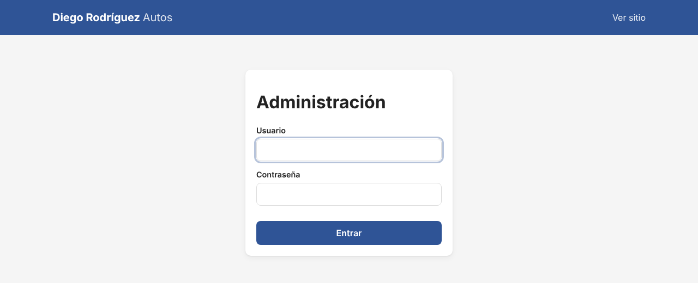
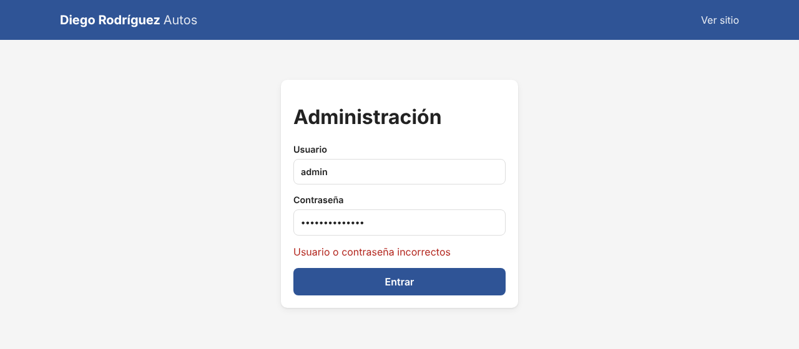
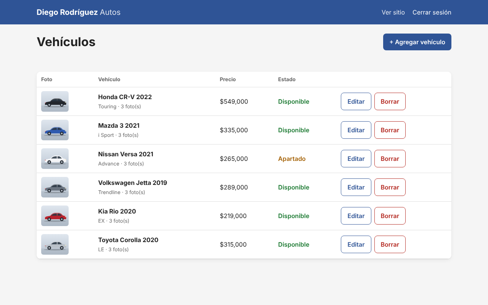
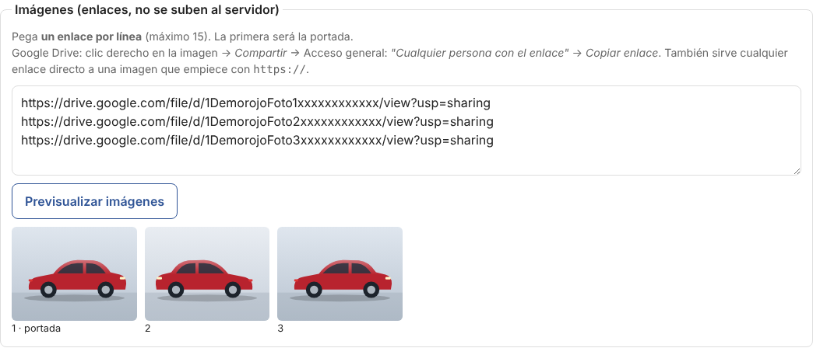
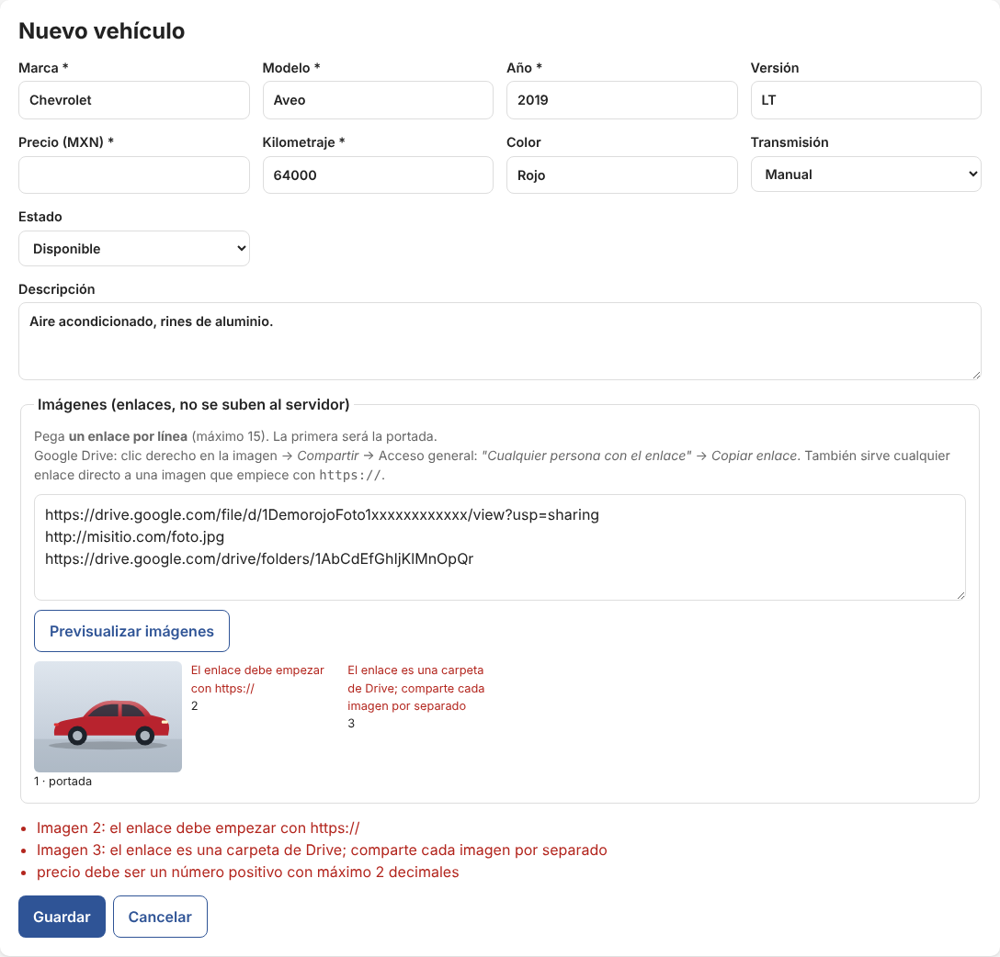

# 2. Panel de administración

[← Volver al índice](README.md)

Desde `https://diegorodriguezautos.com/admin` se maneja todo el inventario. Solo entra quien tiene el usuario y la contraseña.

> El panel **solo funciona con HTTPS** (con el candado en el navegador). Por seguridad, la sesión no viaja por `http://`.

## Entrar

Escribe tu **usuario** y **contraseña** y presiona **Entrar**.

- Si te equivocas aparece "Usuario o contraseña incorrectos":

  

- Después de **5 intentos fallidos** el acceso se bloquea **15 minutos** desde esa conexión. Así se frena a quien intenta adivinar la contraseña.
- La sesión dura **8 horas**. Después vuelve a pedir la contraseña.
- **Cerrar sesión** (arriba a la derecha) termina la sesión en ese navegador. Úsalo siempre en computadoras que no sean tuyas.

¿Olvidaste la contraseña o quieres cambiarla? Se genera una nueva en el servidor con `npm run crear-admin` (ver [Instalación, paso 6](04-instalacion-vps.md#6-crear-el-env-solo-en-el-servidor)) y se reinicia con `pm2 reload diegorodriguezautos`.

## La lista de vehículos

Aquí aparecen **todos** los autos, incluidos los vendidos, con:

- Miniatura de la portada y número de fotos.
- Precio y **estado** con color: verde = Disponible, naranja = Apartado, gris = Vendido.
- Botones **Editar** y **Borrar**.

## Agregar un vehículo

1. Presiona **+ Agregar vehículo**.
2. Llena el formulario. Los campos con `*` son obligatorios.
3. Pega los links de las fotos (ver abajo).
4. Presiona **Guardar**. El auto aparece de inmediato en la lista y en la página pública (si no está "Vendido").

| Campo | Qué poner | Reglas |
|---|---|---|
| Marca * | Nissan, Toyota… | Máximo 50 caracteres |
| Modelo * | Versa, Corolla… | Máximo 60 |
| Año * | 2021 | Entre 1950 y el año siguiente al actual |
| Versión | Advance, LE, Touring… | Opcional, máximo 80 |
| Precio (MXN) * | 265000 | Sin comas ni signo de pesos; hasta 2 decimales |
| Kilometraje * | 38000 | Número entero, sin comas |
| Color | Blanco | Opcional, máximo 30 |
| Transmisión | Automática / Manual | |
| Estado | Disponible / Apartado / Vendido | Ver [Estados](#estados) |
| Descripción | Detalles, equipamiento, servicios… | Opcional, máximo 2000. Respeta los saltos de línea |
| Imágenes | Links de Google Drive, uno por línea | Máximo 15. La primera es la portada |

## Fotos

Pega en **Imágenes** el link de cada foto, **uno por línea**. La primera será la portada. Luego presiona **Previsualizar imágenes** para comprobar que se ven antes de guardar:

El paso a paso para sacar los links de Google Drive está en [3. Fotos desde Google Drive](03-fotos-google-drive.md).

- **Cambiar la portada:** mueve ese link a la primera línea.
- **Quitar una foto:** borra su línea.
- **Reordenar:** cambia el orden de las líneas. Se guardan en ese orden.

## Si algo está mal

El panel no guarda nada hasta que todo está correcto, y te dice exactamente qué corregir:

En este ejemplo:

- La imagen 2 empieza con `http://` (sin la "s"). Solo se aceptan links seguros `https://`.
- La imagen 3 es el link de una **carpeta** de Drive. Hay que compartir cada foto por separado.
- Falta el precio.

## Editar un vehículo

Presiona **Editar** en la fila del auto. El formulario se llena con sus datos actuales; cambia lo necesario y presiona **Guardar**.

> Los links de Drive se ven distintos a como los pegaste (`drive.google.com/thumbnail?id=…`). Es normal: el sistema los convierte a un formato que el navegador puede mostrar como imagen. Puedes dejarlos así o pegar links nuevos con el formato normal.

**Cancelar** cierra el formulario sin guardar cambios.

## Estados

| Estado | En la página pública | Cuándo usarlo |
|---|---|---|
| **Disponible** | Se ve normal | El auto está a la venta |
| **Apartado** | Se ve con la etiqueta naranja "Apartado" | Un cliente dejó anticipo o lo está tramitando |
| **Vendido** | **No aparece** | Ya se vendió. Se conserva en el panel como historial |

Para cambiar el estado: **Editar** → elige el estado → **Guardar**.

## Borrar un vehículo

Presiona **Borrar**; el navegador pide confirmación. **No se puede deshacer** (sus links de fotos también se borran; las fotos en tu Drive no se tocan).

> Si el auto tiene una **venta registrada** en la base de datos, el sistema no deja borrarlo y te pide marcarlo como "Vendido". Así no se pierde el historial de ventas y pagos.

En general es mejor marcar como **Vendido** que borrar.

## Buenas prácticas

- Usa una contraseña de al menos 12 caracteres que no uses en otro lado.
- No compartas el usuario del panel; si alguien más necesita entrar, cambia la contraseña cuando ya no lo necesite.
- Cierra sesión en computadoras ajenas.
- El panel acepta cualquier texto en los campos (comillas, símbolos, etc.) y siempre lo muestra tal cual. Las protecciones contra inyecciones están explicadas en [6. Seguridad](06-seguridad.md).
