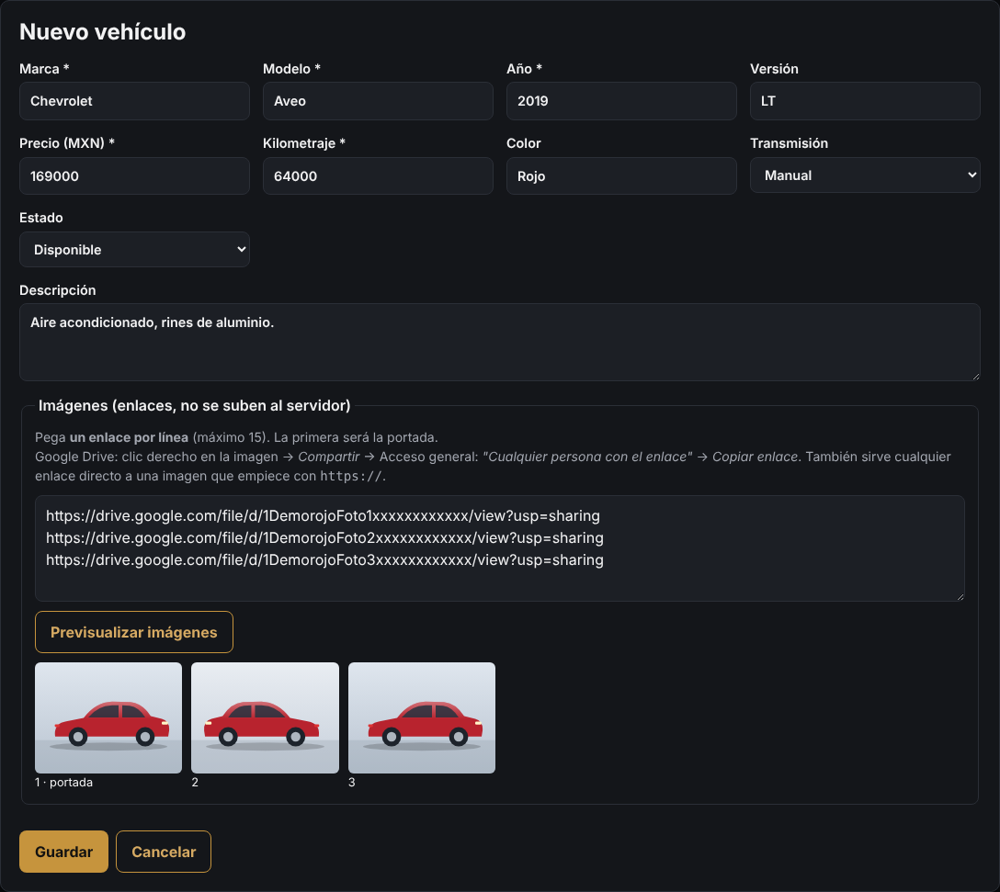
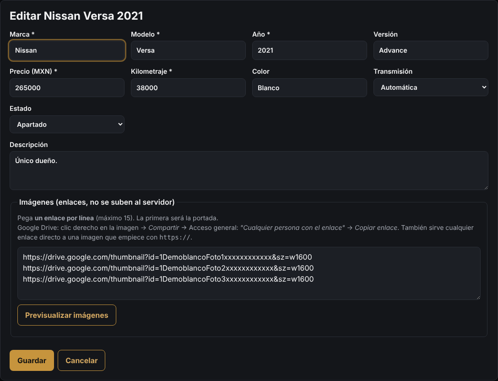
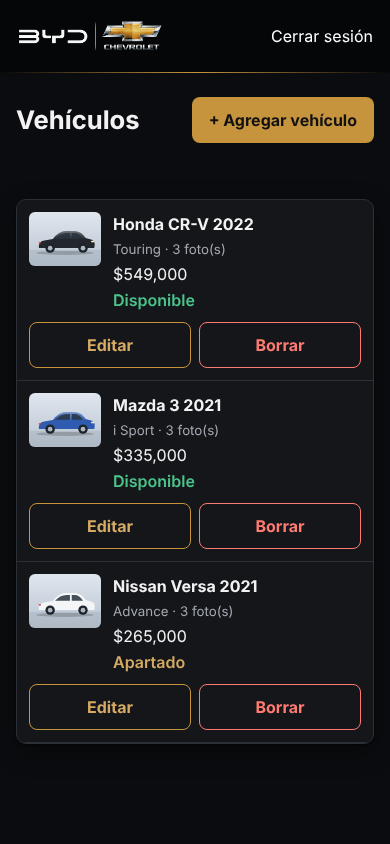
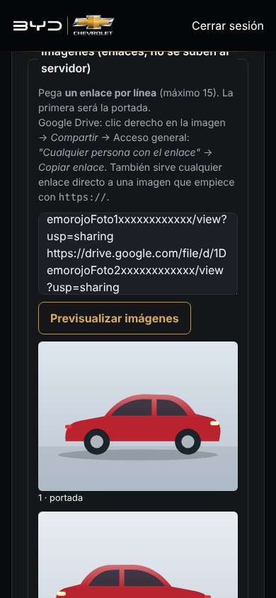

# 10. Inventario paso a paso: agregar, actualizar y subir fotos

[← Volver al índice](README.md)

Guía rápida para el día a día. El detalle de cada pantalla está en [2. Panel de administración](02-panel-admin.md) y [3. Fotos desde Google Drive](03-fotos-google-drive.md).

```
 📸 Tomas fotos  →  ☁️ Las subes a Google Drive  →  🔗 Copias sus links  →  🛠️ Los pegas en el panel  →  ✅ Aparecen en el sitio
```

> **Antes de empezar:** el panel está en **https://diegorodriguezautos.com/admin** y solo funciona con **https** (con candado). Si todavía no abre, corre el diagnóstico: `bash /var/www/diegorodriguezautos.com/deploy/diagnostico.sh`.

---

## A. Agregar un auto nuevo

### 1. Toma las fotos

- **Horizontales** (el celular acostado). El sitio las muestra en formato 4:3; las verticales salen recortadas.
- Con luz de día, el auto limpio y el fondo despejado.
- Orden recomendado (la **primera es la portada**):
  1. Frente en diagonal (¾): la mejor foto, será la portada.
  2. Lateral completo.
  3. Trasera en diagonal.
  4. Tablero y volante.
  5. Asientos delanteros.
  6. Asientos traseros.
  7. Cajuela.
  8. Rines y llantas.
  9. Motor.
  10. Odómetro (para que se vea el kilometraje).
- No necesitas reducirlas: el sitio pide a Google una versión ligera automáticamente.
- Evita que salgan documentos, facturas o personas. La placa puedes taparla si prefieres: cualquiera con el link puede ver la foto.

### 2. Súbelas a Google Drive

**Una sola vez:** crea una carpeta **Inventario** en tu Drive y compártela:

1. Clic derecho en la carpeta → **Compartir**.
2. En *Acceso general* elige **"Cualquier persona con el enlace"**, con rol **Lector**.
3. **Listo**.

Todo lo que pongas dentro quedará visible con su link y no tendrás que compartir foto por foto.

**Por cada auto:** dentro de *Inventario*, crea una carpeta con su nombre (por ejemplo `Nissan Versa 2021 blanco`) y sube ahí sus fotos.

| En la computadora | En el celular (app Google Drive) |
|---|---|
| drive.google.com → abre la carpeta → arrastra las fotos | Abre la carpeta → botón **+** → **Subir** → elige las fotos |

### 3. Copia el link de cada foto

| En la computadora | En el celular |
|---|---|
| Clic derecho en la foto → **Compartir** → **Copiar enlace** | **⋮** junto a la foto → **Copiar vínculo** (o *Compartir → Copiar enlace*) |

- Copia **cada foto**, no la carpeta. El link de una foto tiene `/file/d/`; el de una carpeta tiene `/folders/` y no sirve.
- Junta los links **en el orden** en que quieres que aparezcan, uno por línea. Puedes ir pegándolos en una nota o directo en el panel.

### 4. Captura el auto en el panel

1. Entra a **/admin** con tu usuario y contraseña.
2. Presiona **+ Agregar vehículo**.
3. Llena los datos:

   | Campo | Ejemplo | Ojo |
   |---|---|---|
   | Marca * | `Chevrolet` | |
   | Modelo * | `Aveo` | |
   | Año * | `2019` | |
   | Versión | `LT` | Llénala siempre: la gente busca así en Google |
   | Precio (MXN) * | `169000` | **Sin** `$` ni comas |
   | Kilometraje * | `64000` | Sin comas. `0` si es nuevo |
   | Color | `Rojo` | |
   | Transmisión | Automática / Manual | |
   | Estado | **Disponible** | |
   | Descripción | `Único dueño, servicios de agencia, rines de aluminio. Acepto tu auto a cuenta.` | Respeta los saltos de línea |

4. En **Imágenes**, pega los links, **uno por línea** (máximo 15). El primero es la portada.
5. Presiona **Previsualizar imágenes**: deben verse todas. Si alguna dice "No se pudo cargar", revisa la tabla de problemas al final.
6. Presiona **Guardar**.



### 5. Revisa y comparte

- Abre **https://diegorodriguezautos.com**: el auto nuevo aparece **primero**.
- Toca su foto → **Ver ficha completa**. Esa página (`/autos/…`) es la que conviene **compartir por WhatsApp o redes**: la vista previa muestra la portada, el precio y el nombre.
- Google la encuentra solo (está en el `sitemap.xml`). Puede tardar unos días en aparecer en búsquedas.

---

## B. Actualizar un auto

En el panel, busca el auto en la lista y presiona **Editar**. Cambia lo necesario y presiona **Guardar**.

| Quiero… | Hago… |
|---|---|
| **Cambiar el precio** | Editar → *Precio* → Guardar |
| **Marcarlo apartado** | Editar → *Estado*: **Apartado** → Guardar. Sigue visible con la etiqueta dorada "Apartado" |
| **Marcarlo vendido** | Editar → *Estado*: **Vendido** → Guardar. Desaparece del sitio y de Google; queda en tu panel como historial |
| **Volver a ponerlo a la venta** | Editar → *Estado*: **Disponible** |
| **Agregar una foto** | Súbela a la carpeta del auto en Drive → copia su link → Editar → pégalo en una **línea nueva** en *Imágenes* → Previsualizar → Guardar |
| **Cambiar la portada** | Editar → mueve el link de la foto que quieres a la **primera línea** → Guardar |
| **Quitar una foto** | Editar → borra su línea → Guardar. La foto sigue en tu Drive |
| **Cambiar el orden de las fotos** | Editar → reordena las líneas → Guardar |
| **Reemplazar una foto por otra mejor** | Borra la línea vieja y pega el link nuevo en su lugar |
| **Corregir kilometraje, versión o descripción** | Editar → corrige → Guardar |
| **Borrarlo** | Solo si lo capturaste por error: **Borrar** → confirmar. Si se vendió, mejor márcalo **Vendido** |



> Al editar, los links que ya estaban se ven como `drive.google.com/thumbnail?id=…`. **Es normal**: el sistema los convirtió para que se vean como imagen. Puedes dejarlos así y pegar los nuevos con el formato normal; se mezclan sin problema.

Los cambios se ven en el sitio **de inmediato**. Si no los ves, recarga la página.

---

## C. Todo desde el celular

El panel se adapta al celular: cada auto aparece como tarjeta con sus botones **Editar** y **Borrar**.

| Lista de autos | Pegar y previsualizar fotos |
|---|---|
|  |  |

1. Toma las fotos con el celular.
2. App **Google Drive** → carpeta del auto → **+** → **Subir**.
3. En cada foto: **⋮** → **Copiar vínculo**.
4. En el navegador abre **diegorodriguezautos.com/admin** → **Editar** (o **+ Agregar vehículo**) → mantén presionado en *Imágenes* → **Pegar**. Repite con cada foto, una por línea.
5. **Previsualizar imágenes** → **Guardar**.

> Truco: en el navegador del celular usa *Agregar a pantalla de inicio* sobre la página `/admin` para abrir el panel como una app.

---

## D. Si algo no sale

| Ves… | Qué pasa | Solución |
|---|---|---|
| "No se pudo cargar. ¿Está compartida…?" | La foto no es pública | Comparte la carpeta *Inventario* (paso A.2) o esa foto como "Cualquier persona con el enlace" y vuelve a previsualizar |
| "El enlace es una carpeta de Drive…" | Copiaste el link de la carpeta | Abre la carpeta y copia el link **de cada foto** |
| "El enlace debe empezar con https://" | Link incompleto o de otro tipo | Cópialo otra vez con *Copiar enlace* |
| "No se encontró el ID del archivo de Drive" | El link quedó cortado | Cópialo otra vez completo |
| "precio debe ser un número…" | Tiene `$`, comas o espacios | Escribe solo números: `169000` |
| "anio debe ser un número entero entre…" | Año fuera de rango | Revisa el año |
| "máximo 15 imágenes" | Pegaste más de 15 links | Deja las 15 mejores |
| "Usuario o contraseña incorrectos" | | Revisa mayúsculas. Si la olvidaste: `bash /var/www/diegorodriguezautos.com/deploy/usuarios-admin.sh contrasena <usuario>` en el VPS |
| "Demasiados intentos" | 5 intentos fallidos | Espera 15 minutos |
| El panel te regresa a "Entrar" | La sesión duró 8 horas y expiró | Vuelve a entrar y revisa en la lista si tu último cambio se guardó; si no, repítelo |
| La foto sale recortada en la tarjeta | Es vertical | Usa fotos horizontales; en la ventana de detalle se ve completa |
| Antes se veía una foto y ahora no | Se borró o movió en Drive, o se le quitó el permiso público | No borres de Drive fotos publicadas; si la cambiaste, pega el link nuevo |

---

## E. Lista rápida antes de presionar Guardar

- [ ] Marca, modelo, año y **versión** llenos.
- [ ] Precio y kilometraje **sin comas ni $**.
- [ ] Descripción con lo que la gente busca: equipamiento, "único dueño", "a crédito", "León".
- [ ] **5 fotos o más**, horizontales, y la mejor en la **primera línea**.
- [ ] **Previsualizar imágenes**: todas se ven.
- [ ] Estado correcto (**Disponible**, **Apartado** o **Vendido**).
