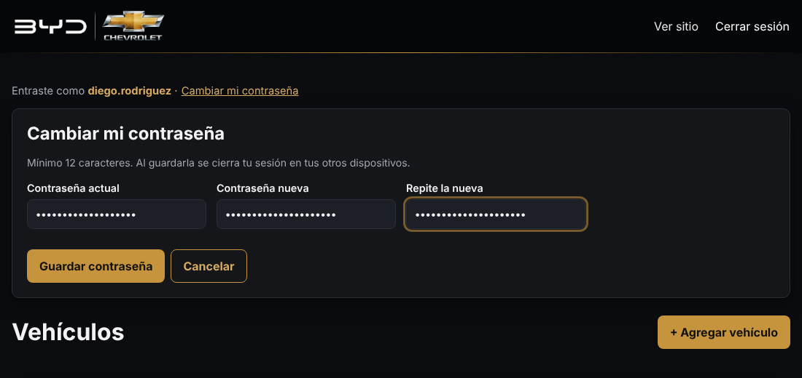

# 11. Tus accesos: versión para tu computadora (desarrollador)

[← Volver al índice](README.md) · La versión para tu cliente es la [guía 12](12-guia-cliente.md).

**Nadie te puede "pasar" las llaves ni las contraseñas, y así debe ser:**

- **Llave SSH:** se crea **en tu computadora**. Solo su parte *pública* sale de ahí. La privada nunca viaja: si viajara, ya no sería solo tuya.
- **Contraseñas del panel:** las escribe cada persona. El servidor solo guarda una huella cifrada (scrypt) y **nadie puede leerlas**, ni tú, ni el servidor, ni Claude. Por eso, si alguien olvida la suya, se le pone una nueva; la anterior no se puede recuperar.

## Quién tiene qué

| Acceso | Tú (desarrollador) | Tu cliente (Diego Rodríguez) |
|---|---|---|
| Panel `/admin` (agregar y editar autos) | ✅ Tu propia cuenta | ✅ **Su** propia cuenta |
| Cambiar su propia contraseña desde el panel | ✅ | ✅ |
| VPS por SSH (servidor, base de datos, `.env`) | ✅ Con tu llave | ❌ No lo necesita |
| hPanel de Hostinger (VPS, dominio, DNS) | ✅ | Solo si él es el dueño de la cuenta; si no, ❌ |
| GitHub (código) | ✅ Con 2FA | ❌ |
| Crear, quitar o resetear cuentas del panel | ✅ Desde el VPS | ❌ Te lo pide a ti |

Regla: **cada quien con lo mínimo que necesita**. El cliente solo maneja el inventario. Si algo le pasa a su contraseña, el sitio, el servidor y el código siguen protegidos.

---

## 1. Crea tu llave SSH (una vez por computadora)

En **tu computadora**, no en el VPS.

**Windows:** abre **PowerShell**. Windows 10 y 11 ya traen SSH; compruébalo con `ssh -V`.
**Mac / Linux:** abre la **Terminal**.

```bash
ssh-keygen -t ed25519 -C "diego-laptop"
```

- **Enter** para aceptar la ruta.
- Escribe una **frase de paso (passphrase)**. Protege la llave si alguien copia tus archivos o te roban la laptop. No se ve mientras escribes.

Se crean dos archivos en tu carpeta `.ssh`:

| Archivo | Qué es | ¿Se comparte? |
|---|---|---|
| `id_ed25519` | Llave **privada** | **Nunca.** Ni por WhatsApp, ni por correo, ni en GitHub, ni a Claude |
| `id_ed25519.pub` | Llave **pública** | Sí: es la que se pega en el VPS y en GitHub |

Copia la pública al portapapeles:

```powershell
# Windows (PowerShell)
Get-Content $env:USERPROFILE\.ssh\id_ed25519.pub | Set-Clipboard
```

```bash
# Mac
pbcopy < ~/.ssh/id_ed25519.pub
# Linux: muéstrala y cópiala con el mouse
cat ~/.ssh/id_ed25519.pub
```

Es una sola línea que empieza con `ssh-ed25519 AAAA...` y termina con `diego-laptop`.

> ¿Usas dos computadoras? Crea **una llave en cada una**, no copies la misma. Si pierdes una, quitas solo esa.

## 2. Ponla en el VPS

**Opción A, hPanel (la más fácil):** hPanel → **VPS** → **Configuración** → **Claves SSH** → **Agregar clave SSH** → ponle de nombre `diego-laptop` → pega la línea → guarda.

**Opción B, desde tu computadora** (te pedirá la contraseña de root una última vez):

```powershell
# Windows (PowerShell)
type $env:USERPROFILE\.ssh\id_ed25519.pub | ssh root@diegorodriguezautos.com "mkdir -p ~/.ssh && chmod 700 ~/.ssh && cat >> ~/.ssh/authorized_keys && chmod 600 ~/.ssh/authorized_keys"
```

```bash
# Mac / Linux
ssh-copy-id root@diegorodriguezautos.com
```

> Si el dominio todavía no apunta al VPS, usa la IP de **hPanel → VPS → Vista general** en lugar de `diegorodriguezautos.com`.

## 3. Entra al VPS

```bash
ssh root@diegorodriguezautos.com
```

La primera vez pregunta *"Are you sure you want to continue connecting?"*: escribe `yes`. Desde ahora pide la **frase de tu llave**, no la contraseña del servidor.

**Atajo:** crea el archivo `.ssh/config` en tu computadora (Windows: `C:\Users\TU_USUARIO\.ssh\config`, sin extensión) con:

```
Host agencia
    HostName diegorodriguezautos.com
    User root
    IdentityFile ~/.ssh/id_ed25519
```

Y ya solo escribes `ssh agencia`.

## 4. Apaga la entrada con contraseña

Cuando `ssh agencia` ya entre con tu llave, apaga las contraseñas: así nadie puede adivinarlas desde internet. Sigue la [guía 5, sección 1.4](05-practica-mysql-ssh.md#14-apagar-el-acceso-con-contraseña-cuando-la-llave-ya-funcione).

- Prueba **en otra terminal** antes de cerrar la que tienes abierta.
- Tu entrada de emergencia, si pierdes la llave, es la **Terminal de hPanel** (en el navegador). Sigue funcionando sin la llave.

## 5. GitHub desde tu computadora

Para subir cambios al código desde tu computadora:

1. **Activa 2FA:** GitHub → Settings → **Password and authentication** → *Two-factor authentication*. Guarda los códigos de recuperación en tu gestor de contraseñas.
2. **Agrega tu llave:** GitHub → Settings → **SSH and GPG keys** → **New SSH key** → Title `diego-laptop` → pega la misma línea `ssh-ed25519 ...` → **Add SSH key**.
3. Prueba y descarga el código:
   ```bash
   ssh -T git@github.com        # debe decir: Hi DieTad01! You've successfully authenticated
   git clone git@github.com:DieTad01/diegorodriguezautos.com.git
   ```

Cómo hacer y publicar cambios: [8. Actualizar con git](08-actualizar-con-git.md).

> La llave que el VPS usa para leer de GitHub (`llave-github.sh`) es **otra** y solo puede leer. No la mezcles con la tuya.

## 6. Tu cuenta del panel

Desde esta versión, **cada persona tiene su propia cuenta** del panel, guardada en la base de datos (tabla `administradores`).

**Tu cuenta actual se conserva:** al correr `actualizar.sh`, el usuario que creaste al instalar pasa solo a la base de datos, **con la misma contraseña**. Compruébalo en el VPS:

```bash
bash /var/www/diegorodriguezautos.com/deploy/actualizar.sh
bash /var/www/diegorodriguezautos.com/deploy/usuarios-admin.sh listar
```

```
USUARIO      NOMBRE        ÚLTIMO ACCESO             CREADA
admin        -             19/10/2026, 10:02:11 a.m. 19/10/2026, 9:40:03 a.m.
```

> Las líneas `ADMIN_USER` y `ADMIN_PASSWORD_HASH` siguen en el `.env`, pero el sitio ya no las usa. Se quedan solo por si algún día regresas a la versión anterior con `actualizar.sh --volver`.

¿Quieres una cuenta con tu nombre en vez de la del instalador? Crea la nueva, entra con ella y luego borra la vieja:

```bash
bash /var/www/diegorodriguezautos.com/deploy/usuarios-admin.sh agregar diegotadeo
# ...entra en /admin con diegotadeo para comprobar que funciona...
bash /var/www/diegorodriguezautos.com/deploy/usuarios-admin.sh quitar admin
```

## 7. Darle acceso a tu cliente (solo al panel)

**1. Crea su cuenta** en el VPS:

```bash
bash /var/www/diegorodriguezautos.com/deploy/usuarios-admin.sh agregar diego.rodriguez
```

Te pide su nombre (por ejemplo `Diego Rodríguez`) y una **contraseña temporal**, dos veces:

- Mínimo 12 caracteres.
- Sin el nombre de usuario dentro.
- No se ve mientras la escribes.

**2. Entrégale los datos con cuidado:**

- **Lo mejor:** en persona. Que **él** escriba en tu laptop la contraseña temporal cuando el script la pida. Así ni tú la sabes.
- **Si no se puede:** dile el usuario por un medio y la contraseña por otro. Por ejemplo, el usuario por WhatsApp y la contraseña en una llamada. **Nunca** los dos en el mismo mensaje.

**3. Que la cambie al primer ingreso.** Dentro del panel: **Cambiar mi contraseña**. Desde ese momento **solo él** la conoce.



**4. Dale su guía:** [12. Guía para el cliente](12-guia-cliente.md). Si el repositorio es privado, él no la puede abrir en GitHub; mándale el PDF (ver abajo).

> **¿Por qué no le das tu cuenta?** Con cuentas separadas:
>
> - Ves quién entró y cuándo (`listar`).
> - Si él pierde el celular, cierras **solo su** sesión sin tocar la tuya.
> - Si un día deja de usar el sitio, borras su cuenta y la tuya sigue igual.

### El PDF para tu cliente

Hay una versión lista para imprimir o mandar por WhatsApp o correo: **[`docs/guia-cliente.pdf`](guia-cliente.pdf)**.

- No trae contraseñas, IPs ni datos del servidor.
- Antes de mandarla, dile por otro medio cuál es su **usuario**.

## 8. Comandos de cuentas (en el VPS)

| Para | Comando |
|---|---|
| Ver las cuentas y su último acceso | `bash /var/www/diegorodriguezautos.com/deploy/usuarios-admin.sh listar` |
| Crear una cuenta | `bash /var/www/diegorodriguezautos.com/deploy/usuarios-admin.sh agregar <usuario>` |
| Poner contraseña nueva (si alguien la olvidó) | `bash /var/www/diegorodriguezautos.com/deploy/usuarios-admin.sh contrasena <usuario>` |
| Sacar a alguien de todos sus dispositivos (perdió el celular) | `bash /var/www/diegorodriguezautos.com/deploy/usuarios-admin.sh cerrar-sesiones <usuario>` |
| Borrar una cuenta | `bash /var/www/diegorodriguezautos.com/deploy/usuarios-admin.sh quitar <usuario>` |

- Cambiar la contraseña de una cuenta **solo** cierra las sesiones de **esa** cuenta.
- No se puede borrar la **última** cuenta: te quedarías sin acceso al panel.
- Los usuarios llevan 3 a 50 letras sin acentos, números, punto, guion o guion bajo (por ejemplo `diego.rodriguez`).

## 9. Si pierdes la laptop o alguien deja el proyecto

| Pasó… | Haz… |
|---|---|
| **Perdiste o te robaron la laptop** | 1. Entra por la **Terminal de hPanel**. 2. Borra la línea de esa llave en `/root/.ssh/authorized_keys` (y en hPanel → Claves SSH). 3. GitHub → Settings → SSH keys → borra `diego-laptop`. 4. Si el panel quedó abierto en el navegador: `usuarios-admin.sh cerrar-sesiones <tu-usuario>` |
| **El cliente perdió el celular** | `usuarios-admin.sh cerrar-sesiones diego.rodriguez`. Si guardó la contraseña en el celular: `contrasena diego.rodriguez` y le das una temporal |
| **El cliente olvidó su contraseña** | `usuarios-admin.sh contrasena diego.rodriguez` → temporal → él la cambia al entrar |
| **Alguien ya no debe entrar** | `usuarios-admin.sh quitar <usuario>`: su sesión deja de servir al instante |
| **Crees que alguien vio el `.env`** | Ver [9. Accesos](09-accesos.md#dónde-están-los-secretos) |

Revisión cada 3 meses: [9. Accesos → Revisión de accesos](09-accesos.md#revisión-de-accesos-cada-3-meses).
