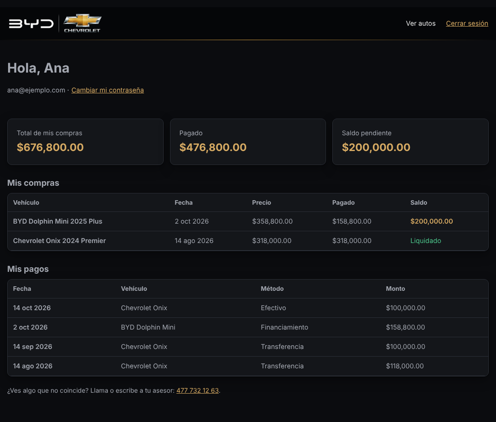
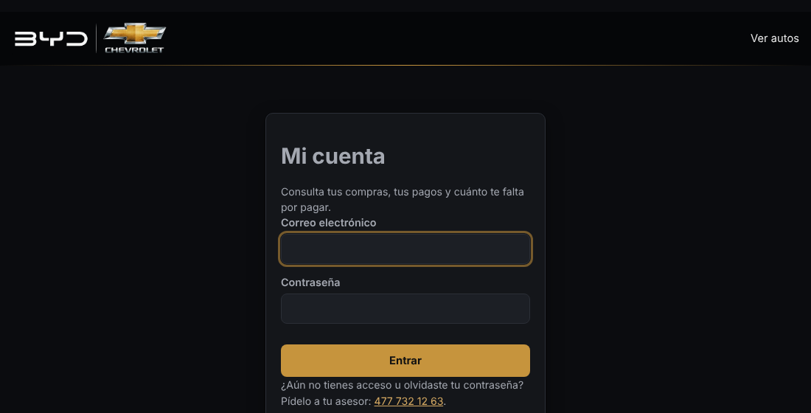
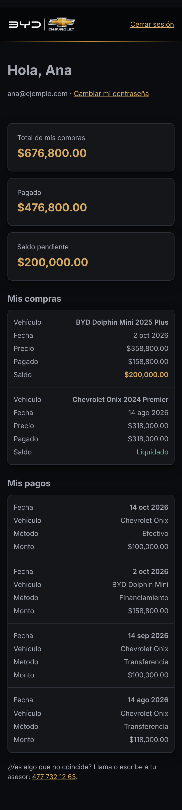

# 15. "Mi cuenta": acceso para los clientes (compradores)

[← Volver al índice](README.md)

Los compradores pueden entrar a **https://diegorodriguezautos.com/mi-cuenta** y consultar **solo sus** compras, pagos y saldo. No pueden cambiar nada, salvo su propia contraseña.



## Quién entra a dónde

| | Administradores | Clientes (compradores) |
|---|---|---|
| Dirección | `/admin` | `/mi-cuenta` (enlace en el pie de página) |
| Usuario | Nombre de usuario | Su **correo** |
| Tabla en la base | `administradores` | `clientes` |
| Qué pueden hacer | Todo el inventario | **Solo ver** sus compras, pagos y saldo |
| Se administra con | `usuarios-admin.sh` | `clientes-acceso.sh` |

**Están separados a propósito.** Cada lado tiene su propia tabla, su propia cookie (`sesion_admin` y `sesion_cliente`) y su propia firma. Una sesión de cliente **no** abre `/admin`, y la de un administrador tampoco sirve como cliente.

## Darle acceso a un cliente

En el VPS (hPanel → VPS → Terminal):

```bash
# 1) Ver clientes, si tienen acceso y su saldo
bash /var/www/diegorodriguezautos.com/deploy/clientes-acceso.sh listar

# 2) Si aún no está registrado: nombre, correo y teléfono
bash /var/www/diegorodriguezautos.com/deploy/clientes-acceso.sh agregar

# 3) Darle acceso con una contraseña TEMPORAL (también si la olvidó)
bash /var/www/diegorodriguezautos.com/deploy/clientes-acceso.sh acceso ana@correo.com
```

- Dale la contraseña temporal **en persona o por llamada**. No la mandes en el mismo mensaje que su correo.
- El cliente entra y la cambia en **Cambiar mi contraseña**. Desde ahí solo él la conoce.
- Para que ya no pueda entrar (sus compras y pagos se conservan):
  ```bash
  bash /var/www/diegorodriguezautos.com/deploy/clientes-acceso.sh quitar-acceso ana@correo.com
  ```

## Registrar ventas y pagos

Por ahora, el panel `/admin` maneja solo el inventario. Las ventas y los pagos se registran con SQL, como root (`mariadb agencia_autos`). El cliente los ve al instante en su cuenta.

```sql
-- Buscar ids
SELECT id, nombre, email FROM clientes;
SELECT id, marca, modelo, anio FROM vehiculos WHERE estado <> 'vendido';

-- Registrar la venta y marcar el auto como vendido
START TRANSACTION;
INSERT INTO ventas (vehiculo_id, cliente_id, fecha, precio_final) VALUES (12, 3, '2026-10-26', 318000);
UPDATE vehiculos SET estado = 'vendido' WHERE id = 12;
COMMIT;

-- Registrar un pago (venta_id = el id de la venta)
INSERT INTO pagos (venta_id, fecha, monto, metodo) VALUES (5, '2026-10-26', 100000, 'transferencia');
```

Los métodos de pago válidos son `efectivo`, `transferencia`, `tarjeta` y `financiamiento`.

## Seguridad

| Protección | Cómo |
|---|---|
| Un cliente no puede ver datos de otro | El id del cliente sale de su sesión firmada, **nunca** de la URL. Poner `?cliente_id=2` no hace nada |
| Contraseñas | Solo se guarda su huella scrypt. Mínimo 12 caracteres y sin el correo dentro |
| Fuerza bruta | 5 intentos fallidos por IP en 15 minutos, más el límite de Nginx |
| Sin acceso | `password_hash` vacío = no puede entrar; quitarlo cierra su sesión al instante |
| Cambiar contraseña | Cierra su sesión en sus otros dispositivos |
| Buscadores | `/mi-cuenta` no se indexa (`noindex` y `robots.txt`) |

Todo esto está cubierto por pruebas automáticas (`npm test`): ver compras ajenas, cambiar el id en la cookie y cruzar cookies de cliente y administrador.

## En el celular

| Entrar | Mi cuenta |
|---|---|
|  |  |
