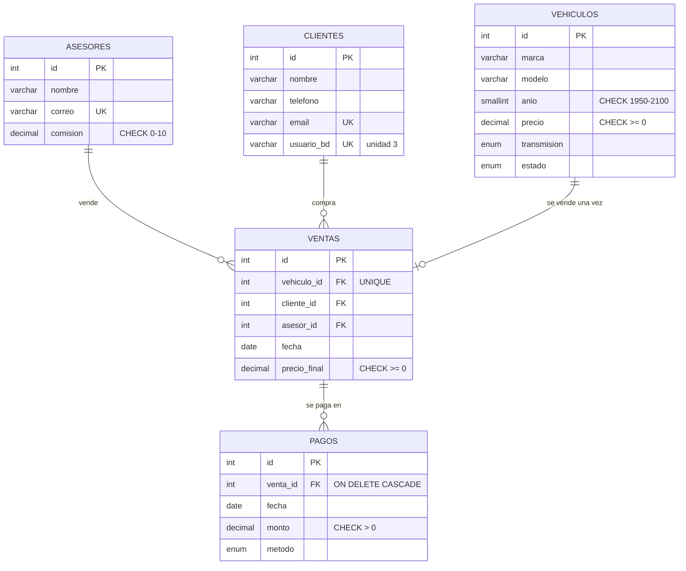

# 16. Proyecto final · Taller de Base de Datos

[← Volver al índice](README.md)

Proyecto integrador que cubre **las 6 unidades** del curso sobre el caso real de este sitio: la agencia de Diego Rodríguez (BYD | Chevrolet, León). Todo corre en MariaDB, en una base **aparte**, `agencia_proyecto`. La base del sitio (`agencia_autos`) no se toca.

| Archivo (`db/proyecto/`) | Unidad |
|---|---|
| `u1-ddl.sql` | 1. Lenguaje de definición de datos |
| `u2-dml.sql` · `u2-errores-restricciones.sql` | 2. Lenguaje de manipulación de datos (y restricciones en acción) |
| `u3-acceso.sql` (+ pruebas en `ejecutar.sh`) | 3. Control de acceso |
| `u4-concurrencia.sql` · `u4-simulador.sh` | 4. Concurrencia |
| `u5-procedural.sql` · `u5-errores.sql` | 5. SQL procedural |
| `u6-conectividad/` (`ConexionJDBC.java`, `conexion_odbc.py`, `probar.sh`) | 6. Conectividad |
| `ejecutar.sh` | Corre todo y guarda las evidencias |

## Cómo correrlo

En tu VPS (hPanel → VPS → Terminal):

```bash
bash /var/www/diegorodriguezautos.com/deploy/actualizar.sh                       # trae el proyecto de GitHub
bash /var/www/diegorodriguezautos.com/db/proyecto/ejecutar.sh --con-conectividad  # corre las 6 unidades
```

Tarda alrededor de un minuto. La primera vez, la unidad 6 instala Java y el conector ODBC.

- **Al terminar** muestra cuántos objetos creó (7 tablas, 5 vistas, 5 procedimientos, 3 funciones, 5 triggers, 6 usuarios y 3 roles) y dónde quedaron las evidencias.
- **Las evidencias** quedan en `/root/evidencias-proyecto/`: un archivo `.txt` por unidad, con cada instrucción y su resultado. Bájalas a tu computadora con:
  ```bash
  scp -r root@diegorodriguezautos.com:/root/evidencias-proyecto .
  ```
- **Las contraseñas** de los usuarios del proyecto (`p_gerente`, `p_ana`, etc.) se generan al azar en cada corrida y quedan en `/root/proyecto-credenciales.env`. Ese archivo solo lo lee root y **no** está en la carpeta de evidencias.
- **Puedes correrlo cuantas veces quieras:** borra y recrea `agencia_proyecto` y los usuarios `p_*` y roles `rol_*`.

## Diagrama entidad-relación



También como imagen: [diagrama-er-proyecto.png](img/diagrama-er-proyecto.png). Cada comando que usa el proyecto está explicado en el [17. Manual de comandos](17-manual-comandos.md).

Además hay dos tablas de apoyo: `bitacora`, que llenan los triggers, y `existencias`, para las demostraciones de concurrencia.

## Cada actividad y su evidencia

### Unidad 1 · Lenguaje de definición de datos

| Actividad | Dónde está | Evidencia |
|---|---|---|
| **A 1.1** Instalación de DBMS | `deploy/instalar.sh` instala MariaDB en el VPS (Debian 13). `u1-ddl.sql` muestra versión, juego de caracteres y carpeta de datos | `u1-ddl.txt` (inicio) |
| **A 1.2** Creación de bases de datos | `u1-ddl.sql`: `CREATE DATABASE` con juego de caracteres y collation | `u1-ddl.txt` |
| **A 1.2.a** Modificar y eliminar una base de datos | `u1-ddl.sql`: `ALTER DATABASE` (cambia `latin1` → `utf8mb4`) y `DROP DATABASE` | `u1-ddl.txt` |
| **A 1.2.b** Diseño en el modelo relacional | Diagrama de arriba. `u1-ddl.sql` crea las tablas con PK, FK, UNIQUE, CHECK, NOT NULL, DEFAULT y ENUM. `u2-errores-restricciones.sql` prueba **11 restricciones** rechazando datos | `u1-ddl.txt` (lista de restricciones) · `u2-errores-restricciones.txt` |
| **A 1.2.c** Modificación del esquema lógico | `u1-ddl.sql`: nueva entidad `asesores` y `ALTER TABLE` (ADD/MODIFY/RENAME COLUMN, ADD CONSTRAINT, ADD INDEX, CREATE/DROP INDEX), además de `TRUNCATE` vs `DROP TABLE` | `u1-ddl.txt` |

### Unidad 2 · Lenguaje de manipulación de datos

| Actividad | Dónde está | Evidencia |
|---|---|---|
| **A 2.0** Bases de datos de ejemplo | `u2-dml.sql` puebla el caso de la agencia: 4 asesores, 12 autos, 6 clientes, 6 ventas y 9 pagos | `u2-dml.txt` |
| **A 2.1.a** Poblar la base de datos | `INSERT` de varias filas e `INSERT ... SELECT` | `u2-dml.txt` |
| **A 2.1.c** Eliminar y actualizar registros | `UPDATE` con subconsulta, descuento con `ROUND` y `ROW_COUNT()`; `DELETE` con `WHERE` | `u2-dml.txt` |
| **A 2.3.a** ORDER BY y GROUP BY | `ORDER BY`/`LIMIT`; `GROUP BY` con `HAVING`; agregados `AVG`, `COUNT`, `MAX`, `MIN`, `SUM`, `GROUP_CONCAT`; funciones de cadena, de fecha y conversión (`CAST`, `CONVERT`, `FORMAT`) | `u2-dml.txt` |
| **A 2.4** Consultas con JOIN | `INNER JOIN` de 4 tablas; `LEFT JOIN` (clientes sin compras); `RIGHT JOIN` (asesora sin ventas); `CROSS JOIN`; `SELF JOIN`. Subconsultas: escalar, `IN`, `NOT EXISTS`, correlacionada y tabla derivada | `u2-dml.txt` |
| **A 2.6** Instrucciones SET | `SET @variable`, `SELECT ... INTO @variable`, `SET lc_time_names`, operadores de conjuntos (`UNION`, `UNION ALL`, `INTERSECT`, `EXCEPT`). Las variables locales con `DECLARE` están en la unidad 5 | `u2-dml.txt` |
| **A 2.7** Vistas | `CREATE VIEW`, `CREATE OR REPLACE`, `ALTER VIEW`, `DROP VIEW`, vista con `WITH CHECK OPTION`, `SHOW CREATE VIEW` e `information_schema` | `u2-dml.txt` · `u2-errores-restricciones.txt` (CHECK OPTION) |
| A 2.7.x Cuestionario / insignia de Microsoft Learn | Es personal: se hace en Microsoft Learn | — |

### Unidad 3 · Control de acceso

| Actividad | Dónde está | Evidencia |
|---|---|---|
| **A 3.1** Usuarios e inicios de sesión | `u3-acceso.sql`: tipos de usuario (root contra usuarios de aplicación), `CREATE USER`, `ALTER USER` (contraseña, límites, `ACCOUNT LOCK/UNLOCK`), `RENAME USER`, `DROP USER`. Ver la nota sobre SQL Server abajo | `u3-acceso.txt` |
| **A 3.3** Otorgar, negar y revocar permisos | `GRANT` a nivel base, tabla, **columna** y procedimiento; `REVOKE`. MariaDB no tiene `DENY`: se otorga solo lo necesario | `u3-acceso.txt` · `u3-pruebas-permisos.txt` |
| **A 3.3.2** Usuarios y permisos en MariaDB | Lo anterior y **20 pruebas automáticas** entrando como cada usuario: lo permitido funciona y lo negado da `ERROR 1142`/`1143` | `u3-pruebas-permisos.txt` |
| **A 3.4.2** Creación de rol nuevo | `CREATE ROLE` (`rol_gerente`, `rol_vendedor`, `rol_cliente`), `GRANT rol TO usuario`, `SET DEFAULT ROLE`, rol dentro de otro rol, y **seguridad por fila**: cada cliente ve solo sus compras con vistas que filtran por `USER()` | `u3-acceso.txt` · `u3-pruebas-permisos.txt` |

### Unidad 4 · Concurrencia

| Actividad | Dónde está | Evidencia |
|---|---|---|
| **A 4.1.1** Simulador de concurrencia | `u4-simulador.sh`: **dos sesiones al mismo tiempo**, con hora exacta, en 6 escenarios: lectura sucia, lectura no repetible, actualización perdida y su solución con `FOR UPDATE`, tiempo de espera de bloqueo (`ERROR 1205`), interbloqueo (`ERROR 1213`), y `NOWAIT`/`SKIP LOCKED` | `u4-simulador.txt` |
| **A 4.1.2** Niveles de aislamiento y transacciones explícitas | `u4-concurrencia.sql`: los 4 niveles, `START TRANSACTION`, `COMMIT`, `ROLLBACK`, `SAVEPOINT`/`ROLLBACK TO`, `autocommit`, `READ ONLY` | `u4-concurrencia.txt` |
| **A 4.5.2** Control de concurrencia en MariaDB | Bloqueos de fila (`FOR UPDATE`, `LOCK IN SHARE MODE`) y de tabla (`LOCK TABLES`), `innodb_lock_wait_timeout`, estadísticas de bloqueos, y procedimiento con transacción y `ROLLBACK` automático (u5) | `u4-concurrencia.txt` · `u4-simulador.txt` · `u5-errores.txt` |
| A 4.4 y A 4.5.1 (en SQL Server) | Ver la nota sobre SQL Server abajo | — |

### Unidad 5 · SQL procedural

| Actividad | Dónde está | Evidencia |
|---|---|---|
| **A 5.1** Procedimientos almacenados | `u5-procedural.sql`: parámetros `IN`, `OUT` e `INOUT`; variables locales (`DECLARE`); `IF`/`CASE`; ciclos `LOOP` con **cursor** y `WHILE`; `SIGNAL`; `registrar_venta` con **transacción** y `EXIT HANDLER` que hace `ROLLBACK`; `ALTER PROCEDURE`; permisos con `GRANT EXECUTE` y `SQL SECURITY DEFINER` | `u5-procedural.txt` · `u5-errores.txt` |
| **A 5.2** Funciones y desencadenadores | Funciones `saldo_venta` (`READS SQL DATA`), `precio_sin_iva` y `categoria_auto` (`DETERMINISTIC`) | `u5-procedural.txt` |
| **A 5.3** Crear desencadenadores | 5 triggers: `BEFORE INSERT` (integridad: no pagar de más), `BEFORE UPDATE` (modifica `NEW` y valida), `AFTER INSERT` (actualiza la tabla relacionada `vehiculos`), `AFTER DELETE` (deshace al cancelar), `AFTER UPDATE` con bitácora usando `OLD`/`NEW` (las "tablas mágicas" de SQL Server). También `DROP TRIGGER` | `u5-procedural.txt` · `u5-errores.txt` |

### Unidad 6 · Conectividad

| Actividad | Dónde está | Evidencia |
|---|---|---|
| **A 6.1** Conexión con ODBC y JDBC | **JDBC:** `ConexionJDBC.java` con MariaDB Connector/J 3.5.1: Statement, PreparedStatement, CallableStatement con parámetro OUT y función, transacción con rollback, y un permiso negado. **ODBC:** DSN en unixODBC, consulta con `isql` y `conexion_odbc.py` con pyodbc (vista, parámetros `?`, procedimiento, rollback) | `u6-conectividad.txt` |
| **A 6.3** Aplicación con Vibe Coding para conexión de BD | **Este sitio**, hecho con Claude Code: Node.js + Express + mysql2 contra MariaDB, con consultas parametrizadas, pool de conexiones y transacciones. Panel `/admin` (CRUD del inventario) y `/mi-cuenta` (cada cliente ve sus compras), con 43 pruebas automáticas (`npm test`) | https://diegorodriguezautos.com · `src/` · `test/` |
| A 6.2 Insignia Vibe Coding | Es personal | — |
| **Proyecto final** | Todo lo anterior | Las carpetas `db/proyecto/` y `/root/evidencias-proyecto/` |

## Nota: actividades en SQL Server

A 3.1 (usuarios de Windows), A 4.4 (transacciones) y A 4.5.1 (modos de bloqueo) piden **SQL Server**, que corre en Windows. Tu VPS es Debian 13, y Microsoft no da soporte oficial a SQL Server en Debian. Ahí entregas lo que hagas en SQL Server en tu computadora. Los **conceptos** están cubiertos en MariaDB, y esta tabla te sirve para explicar la equivalencia:

| SQL Server | MariaDB (este proyecto) |
|---|---|
| `CREATE LOGIN` + `CREATE USER` (dos niveles) | `CREATE USER 'nombre'@'host'` (un solo nivel) |
| Autenticación de Windows | `unix_socket` (root entra por el usuario del sistema) |
| `GRANT` / `DENY` / `REVOKE` | `GRANT` / `REVOKE` (sin `DENY`: se otorga solo lo necesario) |
| Roles fijos de servidor y de base (`db_datareader`…) | `CREATE ROLE` con los permisos que tú definas |
| `BEGIN TRAN` / `COMMIT TRAN` / `ROLLBACK TRAN` | `START TRANSACTION` / `COMMIT` / `ROLLBACK` |
| `SET TRANSACTION ISOLATION LEVEL` (más `SNAPSHOT`) | `SET TRANSACTION ISOLATION LEVEL` (4 niveles) |
| Bloqueos S, X, U, IS/IX; granularidad fila/página/tabla | `LOCK IN SHARE MODE` (S), `FOR UPDATE` (X), `LOCK TABLES`; InnoDB bloquea por fila |
| `WITH (NOLOCK)` | `READ UNCOMMITTED` |
| Tablas `inserted` / `deleted` en triggers | `NEW` / `OLD` |
| `TRY...CATCH` | `DECLARE ... HANDLER` y `RESIGNAL` |

## Cómo presentarlo (unos 10 minutos)

1. **El caso (1 min):** la página real, con el inventario, `/admin` y `/mi-cuenta`, y el diagrama de arriba.
2. **Correr todo en vivo (1 min):** `ejecutar.sh` y el resumen de objetos creados.
3. **Restricciones (1 min):** `u2-errores-restricciones.txt`, las 11 reglas rechazando datos.
4. **Seguridad (2 min):** en `u3-pruebas-permisos.txt`, Ana y Carlos corren `SELECT * FROM mis_compras` y cada uno ve lo suyo; el vendedor puede cambiar el estado de un auto, pero no la marca.
5. **Concurrencia (2 min):** corre `u4-simulador.sh` en vivo. El momento fuerte es la actualización perdida: se vende dos veces el último Onix, y con `FOR UPDATE` la sesión B espera.
6. **Procedural (2 min):** `registrar_venta` con su transacción. En `u5-errores.txt`, una venta que falla a la mitad no deja rastro, y la bitácora registra precios y estados con `OLD`/`NEW`.
7. **Conectividad (1 min):** `probar.sh`: Java y Python leen la misma base, y el usuario de la aplicación no puede borrar tablas.
