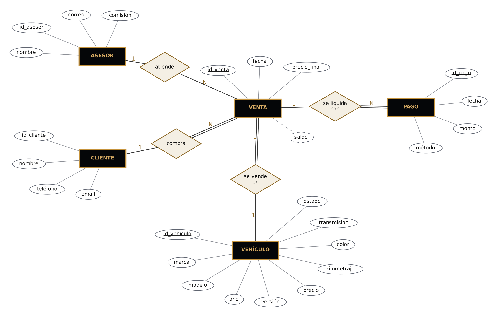
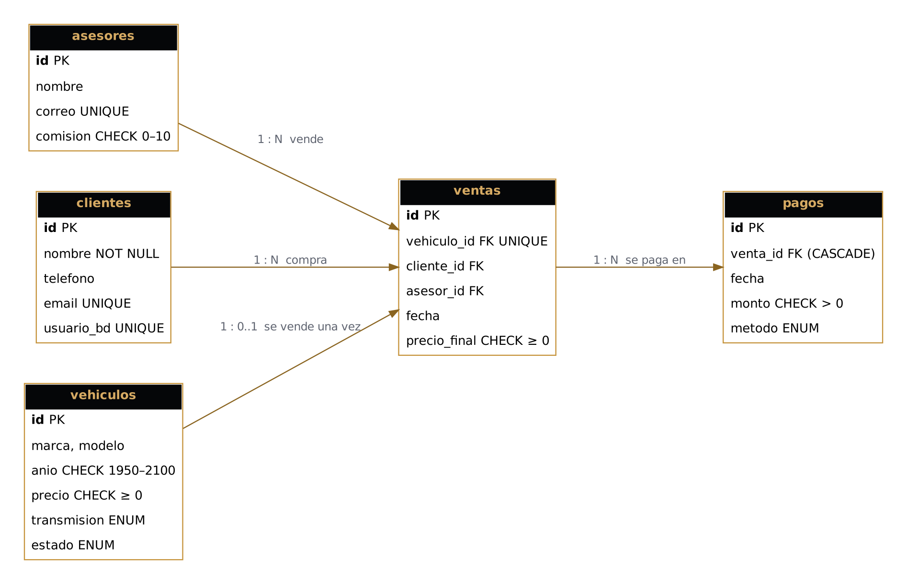

# 18. Reporte del proyecto final · Taller de Base de Datos

[← Volver al índice](README.md) · Comandos explicados: [17. Manual de comandos](17-manual-comandos.md)

Sistema de base de datos para la **agencia de autos de Diego Rodríguez**, asesor de ventas BYD | Chevrolet en León, Guanajuato. Implementado en **MariaDB** sobre un servidor real (VPS de Hostinger, Debian 13) en la base `agencia_proyecto`, con un sistema en **Java** que opera mediante procedimientos almacenados.

Todos los scripts están en `db/proyecto/` y se ejecutan con `ejecutar.sh`. Los scripts completos van en los anexos.

---

## 1. Enunciado semántico y análisis de requerimientos

### 1.1 Enunciado semántico

Diego Rodríguez es asesor de ventas de una agencia BYD | Chevrolet en León, Guanajuato. La agencia necesita una base de datos para controlar su **inventario de vehículos**, sus **clientes**, las **ventas** que realizan sus **asesores** y los **pagos** con los que cada cliente liquida su compra.

De cada **vehículo** se registra un identificador, la marca, el modelo, el año, la versión, el precio de lista, el kilometraje, el color, el tipo de transmisión (automática o manual) y su estado: *disponible* (a la venta), *apartado* (un cliente dejó anticipo o lo está tramitando) o *vendido*. El precio nunca es negativo y el año está entre 1950 y 2100.

De cada **cliente** se registra un identificador, su nombre, teléfono y correo electrónico. El correo es opcional, pero no puede repetirse entre clientes.

De cada **asesor** se registra un identificador, su nombre, su correo (único) y el porcentaje de comisión que gana por venta, entre 0 % y 10 %.

Una **venta** registra la fecha y el precio final pactado, que puede ser distinto al de lista por descuentos o negociación. Cada venta corresponde a **un solo vehículo**, que solo puede venderse **una vez**, y a **un solo cliente**, que puede comprar varios vehículos a lo largo del tiempo. Normalmente la atiende un asesor, que puede atender muchas ventas.

Una venta se liquida con uno o varios **pagos**. De cada pago se registra la fecha, el monto (mayor a cero) y el método: efectivo, transferencia, tarjeta o financiamiento. La suma de los pagos **nunca puede exceder** el precio final; la diferencia es el **saldo** pendiente, que se calcula y no se guarda.

Cuando se registra una venta, el vehículo debe pasar automáticamente a *vendido*. Si la venta se cancela, se borran sus pagos y el vehículo vuelve a estar *disponible*. No se puede cambiar el precio de un vehículo ya vendido, ni borrar a un cliente que tiene compras, para conservar el historial.

Hay distintos **tipos de usuario**:

- El **gerente** administra todo.
- El **vendedor** consulta la información, registra clientes, ventas y pagos, y solo puede cambiar el precio o el estado de un vehículo.
- Cada **cliente** consulta únicamente **sus propias** compras, pagos y saldo.
- Un usuario de **consulta** solo ve el inventario y el nombre de los clientes.
- La **aplicación** de la agencia opera exclusivamente mediante procedimientos almacenados.

Como varios vendedores trabajan al mismo tiempo, la base debe evitar que el último vehículo se venda dos veces y que un pago se pierda. Por eso las operaciones de varios pasos se ejecutan como **transacciones**.

### 1.2 Requerimientos funcionales

| Clave | Requerimiento | Cómo se cumple |
|---|---|---|
| RF1 | Consultar el inventario disponible, con filtros por marca y precio máximo | Procedimiento `buscar_vehiculos`; vista `vista_inventario` |
| RF2 | Registrar, actualizar y dar de baja clientes | `alta_cliente`, `actualizar_cliente`, `baja_cliente` |
| RF3 | Registrar una venta con su enganche como una sola operación | `registrar_venta` (transacción) |
| RF4 | Registrar pagos y conocer el saldo | `registrar_pago`, función `saldo_venta`, vista `vista_saldos` |
| RF5 | Consultar el estado de cuenta de un cliente | `estado_cuenta`; vistas `mis_compras` y `mis_pagos` |
| RF6 | Actualizar el precio y apartar o liberar un vehículo | `actualizar_precio`, `cambiar_estado_vehiculo` |
| RF7 | Cancelar una venta | `cancelar_venta` (transacción) y el trigger `trg_ventas_cancela` |
| RF8 | Reportes: ventas del mes y comisiones por asesor | `ventas_del_mes`, `calcular_comisiones` |
| RF9 | Bitácora de los cambios de precio y de estado | Triggers `trg_vehiculos_bitacora` y `trg_ventas_marca_vendido` |
| RF10 | Cada cliente consulta solo su información | Vistas `mis_compras` y `mis_pagos` filtradas por `USER()` y `rol_cliente` |

### 1.3 Reglas de negocio (integridad)

| Clave | Regla | Mecanismo |
|---|---|---|
| RN1 | Un vehículo se vende una sola vez | `UNIQUE (vehiculo_id)` en `ventas` |
| RN2 | Precio ≥ 0; año entre 1950 y 2100; comisión de 0 a 10; monto > 0 | Restricciones `CHECK` |
| RN3 | Estado, transmisión y método de pago solo admiten valores definidos | Tipo `ENUM` |
| RN4 | Toda venta y todo pago apuntan a registros existentes | `FOREIGN KEY` (integridad referencial) |
| RN5 | La suma de pagos no excede el precio final | Trigger `trg_pagos_valida` |
| RN6 | Al vender, el vehículo pasa a *vendido*; al cancelar, vuelve a *disponible* | Triggers `trg_ventas_marca_vendido` y `trg_ventas_cancela` |
| RN7 | No se cambia el precio de un vehículo vendido | Trigger `trg_vehiculos_limpia` |
| RN8 | No se borra un cliente con compras | `FOREIGN KEY` sin `CASCADE` y validación en `baja_cliente` |
| RN9 | El correo de un cliente o de un asesor no se repite | `UNIQUE` |

### 1.4 Requerimientos no funcionales

| Clave | Requerimiento |
|---|---|
| RNF1 | **SGBD:** MariaDB 11.8 en Debian 13 (probado también en 10.11), motor InnoDB, `utf8mb4` |
| RNF2 | **Seguridad:** usuarios con privilegios mínimos; el puerto 3306 no se expone a internet; contraseñas aleatorias que nunca se guardan en el repositorio |
| RNF3 | **Concurrencia:** transacciones ACID, aislamiento `REPEATABLE READ` y bloqueo de filas (`FOR UPDATE`) al vender |
| RNF4 | **Conectividad:** acceso desde Java (JDBC) y Python (ODBC) |
| RNF5 | **Reproducibilidad:** un solo script (`ejecutar.sh`) crea todo desde cero y guarda evidencias |

---

## 2. Modelo entidad-relación



**Simbología (notación de Chen):**

| Símbolo | Significa |
|---|---|
| Rectángulo | Entidad |
| Rombo | Relación |
| Elipse | Atributo |
| Atributo <u>subrayado</u> | Atributo identificador (llave) |
| Elipse punteada | Atributo derivado: se calcula, no se guarda (`saldo`) |
| Línea doble | Participación **total**: toda ocurrencia participa |
| Línea sencilla | Participación **parcial** |
| `1`, `N` | Cardinalidad de la relación |

**Entidades:**

| Entidad | Identificador | Atributos |
|---|---|---|
| ASESOR | id_asesor | nombre, correo, comisión |
| CLIENTE | id_cliente | nombre, teléfono, email |
| VEHÍCULO | id_vehículo | marca, modelo, año, versión, precio, kilometraje, color, transmisión, estado |
| VENTA | id_venta | fecha, precio_final, *saldo (derivado)* |
| PAGO | id_pago | fecha, monto, método |

**Relaciones:**

| Relación | Entidades | Cardinalidad | Participación |
|---|---|---|---|
| atiende | ASESOR – VENTA | 1 : N (un asesor atiende muchas ventas) | Parcial en ambos lados: puede haber asesores sin ventas y una venta puede registrarse sin asesor |
| compra | CLIENTE – VENTA | 1 : N (un cliente hace muchas compras) | **Total de VENTA**: toda venta tiene un cliente. Parcial de CLIENTE: puede no haber comprado aún |
| se vende en | VEHÍCULO – VENTA | 1 : 1 (un vehículo se vende a lo más una vez) | **Total de VENTA**: toda venta es de un vehículo. Parcial de VEHÍCULO: el inventario no vendido no participa |
| se liquida con | VENTA – PAGO | 1 : N (una venta se paga en varias partes) | **Total de PAGO**: todo pago pertenece a una venta. Parcial de VENTA: puede no tener pagos aún |

**Decisión de diseño:** VENTA se modela como **entidad**, no como relación entre cliente y vehículo, porque tiene atributos propios (fecha, precio_final) y porque a su vez se relaciona con PAGO.

---

## 3. Modelo relacional

El modelo E-R se transforma con estas reglas:

1. Cada entidad se convierte en una tabla, y su identificador en la llave primaria.
2. En cada relación 1:N, la llave del lado "1" pasa como **llave foránea** al lado "N" (por ejemplo, `ventas.cliente_id`).
3. En la relación 1:1 VEHÍCULO–VENTA, la llave foránea va en VENTA (`vehiculo_id`) con restricción `UNIQUE`, que garantiza el "a lo más una vez".
4. La participación total se implementa con `NOT NULL` en la llave foránea. La parcial de VENTA en *atiende* permite `NULL` (`asesor_id`).
5. El atributo derivado `saldo` **no** se convierte en columna: se calcula con la función `saldo_venta` y la vista `vista_saldos`.

**Esquema** (<u>subrayado</u> = llave primaria, *cursiva* = llave foránea):

- **asesores** (<u>id</u>, nombre, correo, comision)
- **clientes** (<u>id</u>, nombre, telefono, email, usuario_bd, registrado_en)
- **vehiculos** (<u>id</u>, marca, modelo, anio, version, precio, kilometraje, color, transmision, estado, descripcion, creado_en)
- **ventas** (<u>id</u>, *vehiculo_id* → vehiculos.id, *cliente_id* → clientes.id, *asesor_id* → asesores.id, fecha, precio_final)
- **pagos** (<u>id</u>, *venta_id* → ventas.id, fecha, monto, metodo)

Tablas de apoyo, fuera del modelo de negocio:

- **bitacora** (<u>id</u>, tabla, accion, detalle, usuario, fecha): la llenan los triggers.
- **existencias** (<u>modelo</u>, unidades): para las demostraciones de concurrencia (unidad 4).



**Detalle de columnas y restricciones de dominio:**

| Tabla.columna | Tipo | Nulo | Restricción |
|---|---|---|---|
| vehiculos.id | INT UNSIGNED | No | PK, AUTO_INCREMENT |
| vehiculos.marca / modelo | VARCHAR(50) / VARCHAR(60) | No | — |
| vehiculos.anio | SMALLINT UNSIGNED | No | CHECK 1950–2100 |
| vehiculos.precio | DECIMAL(12,2) | No | CHECK ≥ 0 |
| vehiculos.kilometraje | INT UNSIGNED | No | DEFAULT 0 |
| vehiculos.transmision | ENUM('automatica','manual') | No | DEFAULT 'automatica' |
| vehiculos.estado | ENUM('disponible','apartado','vendido') | No | DEFAULT 'disponible'; índice |
| clientes.email | VARCHAR(120) | Sí | UNIQUE |
| asesores.correo | VARCHAR(120) | No | UNIQUE |
| asesores.comision | DECIMAL(4,2) | No | DEFAULT 1.50; CHECK 0–10 |
| ventas.vehiculo_id | INT UNSIGNED | No | FK; UNIQUE |
| ventas.cliente_id | INT UNSIGNED | No | FK |
| ventas.asesor_id | INT UNSIGNED | Sí | FK |
| ventas.precio_final | DECIMAL(12,2) | No | CHECK ≥ 0 |
| pagos.venta_id | INT UNSIGNED | No | FK ON DELETE CASCADE |
| pagos.monto | DECIMAL(12,2) | No | CHECK > 0 |
| pagos.metodo | ENUM('efectivo','transferencia','tarjeta','financiamiento') | No | — |

---

## 4. Normalización

### 4.1 Punto de partida: la nota de venta sin normalizar

Antes del sistema, cada venta se anotaba en una hoja con todos los datos juntos y los pagos uno tras otro. Entre paréntesis van los datos que se escribían en la misma casilla:

| folio | fecha | cliente (tel, email) | asesor (correo, comisión) | vehículo (id, marca, modelo, año, precio lista) | precio final | pagos (fecha, monto, método) |
|---|---|---|---|---|---|---|
| 1 | 14/08/2026 | Ana López (4771234567, ana@…) | Diego R. (diego@…, 2.00) | 2, Chevrolet, Onix, 2024, 325000 | 318000 | (14/08, 118000, transf.), (14/09, 100000, transf.), (14/10, 100000, efectivo) |
| 2 | 02/10/2026 | Ana López (4771234567, ana@…) | Diego R. (diego@…, 2.00) | 6, BYD, Dolphin Mini, 2025, 358800 | 358800 | (02/10, 158800, financ.) |

Problemas de esta forma:

- **Grupo repetitivo:** varios pagos dentro de una sola celda.
- **Redundancia:** los datos de Ana y de Diego se repiten en cada venta.
- **Anomalía de actualización:** si Ana cambia de teléfono, hay que corregir todas sus notas.
- **Anomalía de inserción:** no se puede registrar un cliente ni un vehículo sin una venta.
- **Anomalía de borrado:** al borrar la única venta de un vehículo, se pierden los datos del vehículo.

### 4.2 Dependencias funcionales identificadas

| # | Dependencia funcional | Por qué |
|---|---|---|
| DF1 | folio → fecha, id_cliente, id_asesor, id_veh, precio_final | Cada nota es una venta |
| DF2 | id_veh → folio | Un vehículo se vende una sola vez (llave candidata de la venta) |
| DF3 | (folio, núm_pago) → fecha_pago, monto, método | Cada pago de una nota |
| DF4 | id_cliente → nombre, tel, email | Datos del cliente |
| DF5 | email → id_cliente | El correo no se repite (llave alternativa) |
| DF6 | id_asesor → nombre_asesor, correo_asesor, comisión | Datos del asesor |
| DF7 | correo_asesor → id_asesor | El correo del asesor no se repite |
| DF8 | id_veh → marca, modelo, año, versión, precio_lista, km, color, transmisión, estado | Datos del vehículo |

**No** son dependencias:

- **(marca, modelo, año) ↛ precio:** puede haber varias unidades del mismo modelo con distinto precio o kilometraje.
- **id_veh ↛ precio_final:** el precio final se negocia en cada venta. Es un dato **histórico** de la venta y no repite el precio de lista, que puede cambiar después.

### 4.3 Primera forma normal (1FN)

**Regla:** todos los valores son atómicos y no hay grupos repetitivos.

Se separa cada pago en su propia fila y la llave pasa a ser **(folio, núm_pago)**:

> NOTA_PAGO (<u>folio</u>, <u>núm_pago</u>, fecha, id_cliente, cliente, tel, email, id_asesor, asesor, correo_asesor, comisión, id_veh, marca, modelo, año, …, precio_final, fecha_pago, monto, método)

Queda en 1FN, pero con mucha redundancia: los datos de la venta se repiten en cada pago.

### 4.4 Segunda forma normal (2FN)

**Regla:** 1FN y ningún atributo no clave depende de **una parte** de la llave compuesta.

Casi todos los atributos dependen solo de **folio** (DF1, DF4, DF6, DF8 a través de folio), no de (folio, núm_pago). Son **dependencias parciales**. Se separan:

> VENTA (<u>folio</u>, fecha, id_cliente, cliente, tel, email, id_asesor, asesor, correo_asesor, comisión, id_veh, marca, modelo, año, …, precio_final)
>
> PAGO (<u>folio</u>, <u>núm_pago</u>, fecha_pago, monto, método)

En PAGO, la llave compuesta se reemplaza por una llave sustituta **id** (autoincrementable) y **folio** queda como llave foránea `venta_id`.

### 4.5 Tercera forma normal (3FN)

**Regla:** 2FN y ningún atributo no clave depende de otro atributo no clave (sin **dependencias transitivas**).

En VENTA hay tres dependencias transitivas:

- folio → id_cliente → nombre, tel, email
- folio → id_asesor → nombre_asesor, correo_asesor, comisión
- folio → id_veh → marca, modelo, año, precio_lista, …

Se separa cada una en su propia tabla, dejando solo la llave foránea en VENTA:

> CLIENTES (<u>id</u>, nombre, telefono, email)
>
> ASESORES (<u>id</u>, nombre, correo, comision)
>
> VEHICULOS (<u>id</u>, marca, modelo, anio, version, precio, kilometraje, color, transmision, estado)
>
> VENTAS (<u>id</u>, *vehiculo_id*, *cliente_id*, *asesor_id*, fecha, precio_final)
>
> PAGOS (<u>id</u>, *venta_id*, fecha, monto, metodo)

Con esto desaparecen las tres anomalías. El teléfono de Ana está en un solo lugar. Un vehículo o un cliente existen sin venta. Borrar una venta no borra el vehículo.

### 4.6 Forma normal de Boyce-Codd (FNBC)

**Regla:** en cada dependencia funcional no trivial X → Y, **X es superllave**. Es decir, todo determinante es llave candidata.

Se revisa cada tabla:

| Tabla | Llaves candidatas | Determinantes de sus DF | ¿Todos son llave candidata? |
|---|---|---|---|
| clientes | {id}, {email} | id (DF4), email (DF5) | Sí → **FNBC** |
| asesores | {id}, {correo} | id (DF6), correo (DF7) | Sí → **FNBC** |
| vehiculos | {id} | id (DF8). (marca, modelo, año) no determina nada | Sí → **FNBC** |
| ventas | {id}, {vehiculo_id} | id (DF1), vehiculo_id (DF2) | Sí → **FNBC** |
| pagos | {id} | id (DF3) | Sí → **FNBC** |

La base está en **FNBC**: no quedan dependencias cuyo determinante no sea llave, así que no hay redundancia que provoque anomalías.

Las llaves alternativas se garantizan en la base con `UNIQUE`: `clientes.email`, `asesores.correo` y `ventas.vehiculo_id`. `clientes.email` admite `NULL` para quien no tenga correo; MariaDB permite varios `NULL` en un `UNIQUE`, y cuando hay correo, no se repite.

### 4.7 Datos que se calculan y datos controlados

- **Saldo:** no se guarda (sería redundante: depende de precio_final y de la suma de pagos). Se calcula con `saldo_venta()` y `vista_saldos`, y nunca queda desactualizado.
- **Comisión de cada venta:** no se guarda. Se calcula en `calcular_comisiones` a partir de `asesores.comision`.
- **`vehiculos.estado`:** el valor *vendido* podría deducirse de que exista una venta, pero *apartado* no se deduce de nada, y el estado se consulta en cada búsqueda del inventario. Se conserva como columna **controlada**. Los triggers `trg_ventas_marca_vendido` y `trg_ventas_cancela` lo mantienen siempre consistente con `ventas`, y `cambiar_estado_vehiculo` impide marcar *vendido* a mano.

---

## 5. Script DDL (definición de datos)

Archivo `db/proyecto/u1-ddl.sql` (completo en el **Anexo A**). Incluye:

| Elemento | Detalle |
|---|---|
| Base de datos | `CREATE DATABASE IF NOT EXISTS agencia_proyecto CHARACTER SET utf8mb4 COLLATE utf8mb4_unicode_ci`; además `ALTER DATABASE` y `DROP DATABASE` sobre una base de prueba |
| Tablas | `vehiculos`, `clientes`, `ventas`, `pagos`, `asesores`, `bitacora` (motor InnoDB) |
| Llaves primarias | Todas las tablas, `AUTO_INCREMENT` |
| Integridad referencial | 4 `FOREIGN KEY`: ventas→vehiculos, ventas→clientes, ventas→asesores, pagos→ventas (`ON DELETE CASCADE`) |
| Integridad de dominio | 5 `CHECK` (año, precio, precio_final, monto, comisión); `ENUM` para estado, transmisión y método; `NOT NULL`; `DEFAULT` |
| Llaves alternativas | 3 `UNIQUE`: clientes.email, asesores.correo, ventas.vehiculo_id |
| Índices | `idx_vehiculos_estado`, `idx_vehiculos_marca_modelo`; demostración de `CREATE UNIQUE INDEX` y `DROP INDEX` |
| Modificación del esquema | `ALTER TABLE`: ADD COLUMN, MODIFY, RENAME COLUMN, ADD CONSTRAINT, ADD INDEX |
| Eliminación | `TRUNCATE TABLE` y `DROP TABLE` sobre una tabla temporal |

La evidencia `u2-errores-restricciones.txt` muestra **11 restricciones** rechazando datos inválidos: PK duplicada, UNIQUE, FK al insertar y al borrar, CHECK, NOT NULL, ENUM y WITH CHECK OPTION.

---

## 6. Poblado de la base de datos

Archivo `db/proyecto/u2-dml.sql`, sección 2.1.a (**Anexo B**). Inserta 4 asesores, 12 vehículos (5 BYD y 7 Chevrolet), 6 clientes, 6 ventas y 9 pagos con `INSERT` de varias filas. También demuestra `INSERT … SELECT`, que copia los BYD a una tabla de respaldo.

## 7. Actualización y borrado de registros

| Operación | Ejemplo | Dónde |
|---|---|---|
| UPDATE con subconsulta | Marca como *vendido* todo vehículo que tenga venta | `u2-dml.sql` |
| UPDATE con cálculo | 5 % de descuento a los disponibles de 2023 o antes (`ROW_COUNT()` confirma cuántos) | `u2-dml.sql` |
| UPDATE puntual | Apartar un vehículo | `u2-dml.sql` |
| UPDATE mediante vista | Bajar el precio a través de `vista_disponibles` (con `WITH CHECK OPTION`) | `u2-dml.sql` |
| UPDATE mediante procedimiento | `actualizar_cliente`, `actualizar_precio`, `cambiar_estado_vehiculo` | `u5-procedural.sql` |
| DELETE con condición | Borrar del respaldo los vehículos anteriores a 2025 | `u2-dml.sql` |
| DELETE en transacción | `cancelar_venta`: borra pagos y venta como una unidad | `u5-procedural.sql` |
| DELETE controlado | `baja_cliente`: solo si el cliente no tiene compras | `u5-procedural.sql` |
| TRUNCATE / DROP | Tabla temporal | `u1-ddl.sql` |

## 8. Vistas

Cada vista muestra a cada usuario **solo** la información que necesita:

| Vista | Muestra | La usa |
|---|---|---|
| `vista_inventario` | Vehículos no vendidos: nombre completo, precio, kilometraje, transmisión y estado | Vendedores |
| `vista_saldos` | Cada venta con cliente, vehículo, precio, pagado y saldo | Gerente y vendedores (cobranza) |
| `vista_disponibles` | Vehículos disponibles. Es actualizable con `WITH CHECK OPTION`: no deja marcar un auto como vendido por aquí | Vendedores |
| `mis_compras` | Las compras del cliente **que inició sesión**, con su saldo (filtra por `USER()`) | Rol `rol_cliente` |
| `mis_pagos` | Los pagos del cliente que inició sesión | Rol `rol_cliente` |

`mis_compras` y `mis_pagos` implementan **seguridad por fila**: los clientes no tienen permiso sobre las tablas, solo sobre estas vistas (`SQL SECURITY DEFINER`). Con la misma consulta, Ana ve sus 2 compras y Carlos la suya.

## 9. Usuarios y privilegios

| Usuario | Tipo | Privilegios | Para qué |
|---|---|---|---|
| `p_gerente` | Administrador de la base | Rol `rol_gerente`: `ALL PRIVILEGES` en `agencia_proyecto` (incluye `rol_vendedor`) | Todo, incluidas comisiones, cancelaciones y bajas |
| `p_vendedor` | Operativo | Rol `rol_vendedor`: SELECT de todo; INSERT/UPDATE en clientes; INSERT en ventas y pagos; UPDATE **solo** de `precio` y `estado` de vehículos; EXECUTE de los procedimientos de venta | Atender clientes y registrar ventas y pagos |
| `p_ana`, `p_carlos` | Cliente | Rol `rol_cliente`: SELECT **solo** de `mis_compras` y `mis_pagos` | Consultar su estado de cuenta |
| `p_consulta` | Solo lectura limitada | SELECT de `vehiculos` y `asesores`; de `clientes` **solo** las columnas id y nombre; EXECUTE de `ventas_del_mes` | Consultas y reportes, sin datos de contacto |
| `p_sistema` | Aplicación | **Solo EXECUTE**: no lee ni escribe tablas | El sistema en Java, que opera únicamente por procedimientos |
| `p_app` | Aplicación (pruebas JDBC/ODBC) | SELECT, INSERT, UPDATE, DELETE, EXECUTE. Sin DROP, ALTER ni CREATE | Demostración de conectividad |

`ejecutar.sh` entra como cada usuario y comprueba **23 casos** de permitido o negado (evidencia `u3-pruebas-permisos.txt`). Por ejemplo:

- El vendedor puede cambiar el estado de un auto, pero no la marca (`ERROR 1142`).
- `p_consulta` no puede ver el correo de un cliente (`ERROR 1143`).
- `p_sistema` no puede leer la tabla de clientes, pero sí ejecutar `buscar_vehiculos`.

## 10. Transacciones

**`registrar_venta`** es la transacción principal. Registra la venta y su enganche como **una sola unidad**:

```sql
DECLARE EXIT HANDLER FOR SQLEXCEPTION, SQLWARNING
BEGIN
  ROLLBACK;          -- si cualquier paso falla, se deshace todo
  RESIGNAL;          -- y se avisa el error original
END;
START TRANSACTION;
  SELECT estado INTO v_estado FROM vehiculos WHERE id = p_vehiculo FOR UPDATE;  -- bloquea el auto
  -- valida que exista y que no esté vendido (SIGNAL si no)
  INSERT INTO ventas (...) VALUES (...);          -- el trigger lo marca como vendido
  INSERT INTO pagos  (...) VALUES (...);          -- el trigger valida que no exceda el saldo
COMMIT;
```

Qué protege:

- **Atomicidad:** si el enganche es inválido, por ejemplo mayor que el precio, la venta tampoco se guarda. Lo demuestra `u5-errores.txt`, comprobado desde otra sesión.
- **Concurrencia:** `FOR UPDATE` bloquea el vehículo. Si dos vendedores intentan venderlo al mismo tiempo, el segundo espera y luego encuentra que ya está vendido. El escenario 3 de `u4-simulador.txt` demuestra ese mismo mecanismo con dos sesiones en vivo.
- **Manejo de advertencias:** se atrapan `SQLEXCEPTION` **y** `SQLWARNING`. En modo estricto, un valor inválido en un `ENUM` llega como SQLSTATE `01000` (advertencia), y sin esto escapaba sin `ROLLBACK`. Las pruebas del proyecto detectaron ese caso.

**`cancelar_venta`** es otra transacción: borra los pagos y la venta juntos. `u4-concurrencia.sql` demuestra además `COMMIT`, `ROLLBACK`, `SAVEPOINT`, `autocommit` y los 4 niveles de aislamiento.

## 11. Procedimientos almacenados

| Tipo | Procedimiento | Qué hace |
|---|---|---|
| **Inserción** | `alta_cliente(nombre, teléfono, email, OUT id)` | Valida nombre y correo (formato y que no se repita) e inserta |
| | `registrar_venta(vehículo, cliente, asesor, precio, enganche, método, OUT venta)` | Transacción: venta y enganche |
| | `registrar_pago(venta, monto, método, OUT saldo)` | Inserta el pago y regresa el saldo restante |
| **Actualización** | `actualizar_cliente(id, teléfono, email)` | Cambia los datos de contacto (`NULL` = dejar igual; valida que el correo no sea de otro) |
| | `actualizar_precio(vehículo, precio)` | Cambia el precio (el trigger lo anota en la bitácora y no deja cambiar un vendido) |
| | `cambiar_estado_vehiculo(vehículo, estado)` | Aparta o libera; *vendido* solo con `registrar_venta` |
| **Eliminación** | `cancelar_venta(venta)` | Transacción: pagos y venta; el auto vuelve a disponible |
| | `baja_cliente(id)` | Solo si no tiene compras |
| **Consulta** | `buscar_vehiculos(marca, precio_máx)` | Inventario con filtros opcionales y categoría |
| | `listar_clientes()` | Clientes con número de compras y saldo |
| | `estado_cuenta(cliente)` | Dos resultados: compras con saldo y pagos |
| | `ventas_del_mes(año, mes)` | Reporte mensual |
| | `calcular_comisiones()` | Recorre los asesores con un **cursor** y calcula su comisión y nivel |
| **Otros** | `tabla_de_pagos(venta, meses)` | Plan de pagos con ciclo `WHILE` |
| | `aplicar_descuento(INOUT precio, porcentaje)` | Ejemplo de parámetro `INOUT` |

Funciones de apoyo: `saldo_venta`, `precio_sin_iva` y `categoria_auto`. Todos los procedimientos validan sus datos y responden con un mensaje claro mediante `SIGNAL SQLSTATE '45000'`. Las pruebas de cada validación están en `u5-errores.txt`.

## 12. Triggers

| Trigger | Momento | Qué protege |
|---|---|---|
| `trg_pagos_valida` | BEFORE INSERT en `pagos` | **Consistencia:** un pago nunca excede el saldo de su venta (RN5) |
| `trg_vehiculos_limpia` | BEFORE UPDATE en `vehiculos` | **Integridad:** quita espacios de marca y modelo, y no permite cambiar el precio de un vehículo vendido (RN7) |
| `trg_ventas_marca_vendido` | AFTER INSERT en `ventas` | **Consistencia entre tablas:** el vehículo pasa a *vendido* (RN6) y se anota en la bitácora |
| `trg_ventas_cancela` | AFTER DELETE en `ventas` | **Consistencia entre tablas:** si se cancela la venta, el vehículo vuelve a *disponible* (RN6) |
| `trg_vehiculos_bitacora` | AFTER UPDATE en `vehiculos` | **Auditoría:** registra cada cambio de precio y de estado con el valor anterior (`OLD`) y el nuevo (`NEW`), y el usuario |

## 13. Conexión desde un lenguaje de programación

**Sistema de la agencia** (`db/proyecto/u6-conectividad/SistemaAgencia.java`, **Anexo D**): una aplicación en **Java** que se conecta con **JDBC** (MariaDB Connector/J 3.5.1) y realiza **todas** las operaciones mediante llamadas a procedimientos almacenados (`CallableStatement`):

```
===== Agencia Diego Rodríguez · BYD | Chevrolet =====
 CONSULTA       1) Inventario   2) Clientes   3) Estado de cuenta   4) Ventas del mes
 INSERCIÓN      5) Alta de cliente   6) Registrar venta   7) Registrar pago
 ACTUALIZACIÓN  8) Actualizar cliente   9) Cambiar precio   10) Apartar/liberar auto
 ELIMINACIÓN    11) Cancelar venta   12) Baja de cliente
 0) Salir
```

```java
try (CallableStatement cs = cn.prepareCall("{call registrar_pago(?, ?, ?, ?)}")) {
    cs.setInt(1, venta);
    cs.setBigDecimal(2, monto);
    cs.setString(3, metodo);
    cs.registerOutParameter(4, Types.DECIMAL);   // parámetro OUT: el saldo
    cs.execute();
}
```

- **Se conecta con el usuario `p_sistema`, que solo tiene permiso `EXECUTE`.** El sistema no tiene otra forma de trabajar más que con los procedimientos, que validan todo. Lo demuestra el propio sistema: al intentar `SELECT * FROM clientes` recibe `ERROR 1142`.
- **Los rechazos de la base llegan como mensajes claros al usuario:** correo repetido, pago mayor al saldo, cliente con compras, auto vendido.
- **Maneja procedimientos con varios resultados** (`estado_cuenta` regresa compras y pagos) con `getMoreResults()`.
- **Para correrlo:**
  - Menú interactivo: `bash db/proyecto/u6-conectividad/probar.sh --menu`
  - Recorrido automático de las 12 operaciones con sus casos de error: `probar.sh` (evidencia `u6-conectividad.txt`)

Además, `ConexionJDBC.java` y `conexion_odbc.py` muestran la conexión directa con JDBC y con ODBC (DSN de unixODBC, `isql` y pyodbc). La página web del negocio (diegorodriguezautos.com) es otra aplicación conectada a la base, hecha en Node.js con consultas parametrizadas.

---

## Cómo ejecutar el proyecto

En el servidor, como root:

```bash
bash /var/www/diegorodriguezautos.com/db/proyecto/ejecutar.sh --con-conectividad
```

Crea la base desde cero, ejecuta los scripts de las unidades 1 a 5, prueba los 23 casos de permisos, corre el simulador de concurrencia y la conectividad, y guarda la evidencia de cada parte en `/root/evidencias-proyecto/`.

## Anexos

- **A.** Script DDL completo (`u1-ddl.sql`)
- **B.** Script de poblado de la base (sección 2.1.a de `u2-dml.sql`)
- **C.** Procedimientos almacenados, funciones y triggers (`u5-procedural.sql`)
- **D.** Sistema de la agencia en Java (`SistemaAgencia.java`)

En el repositorio están en `db/proyecto/`; en la versión de Word van impresos completos.
